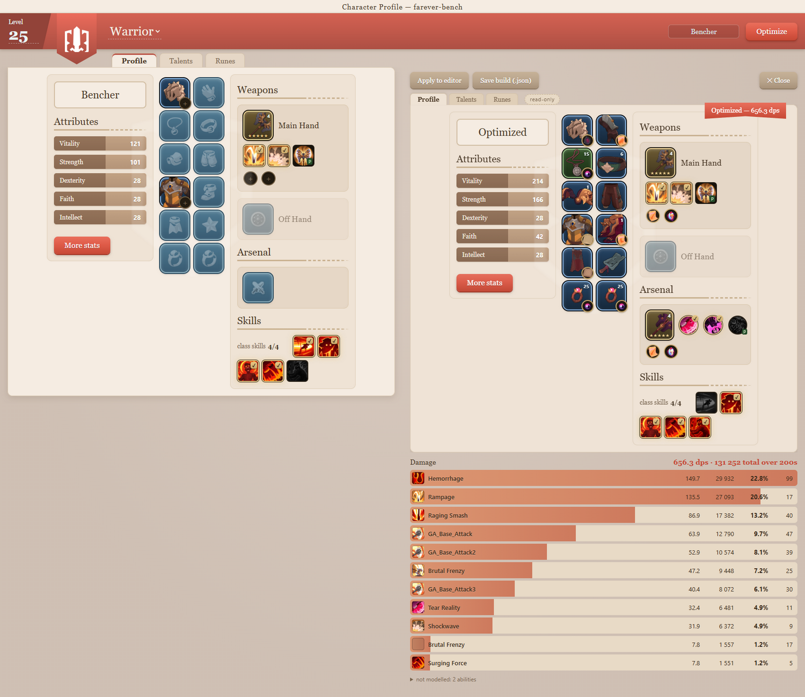
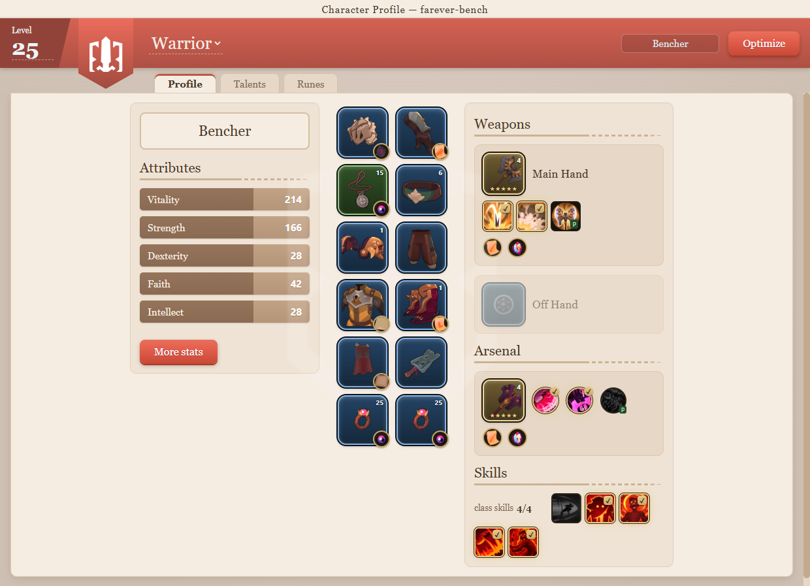
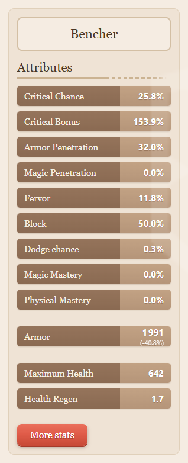
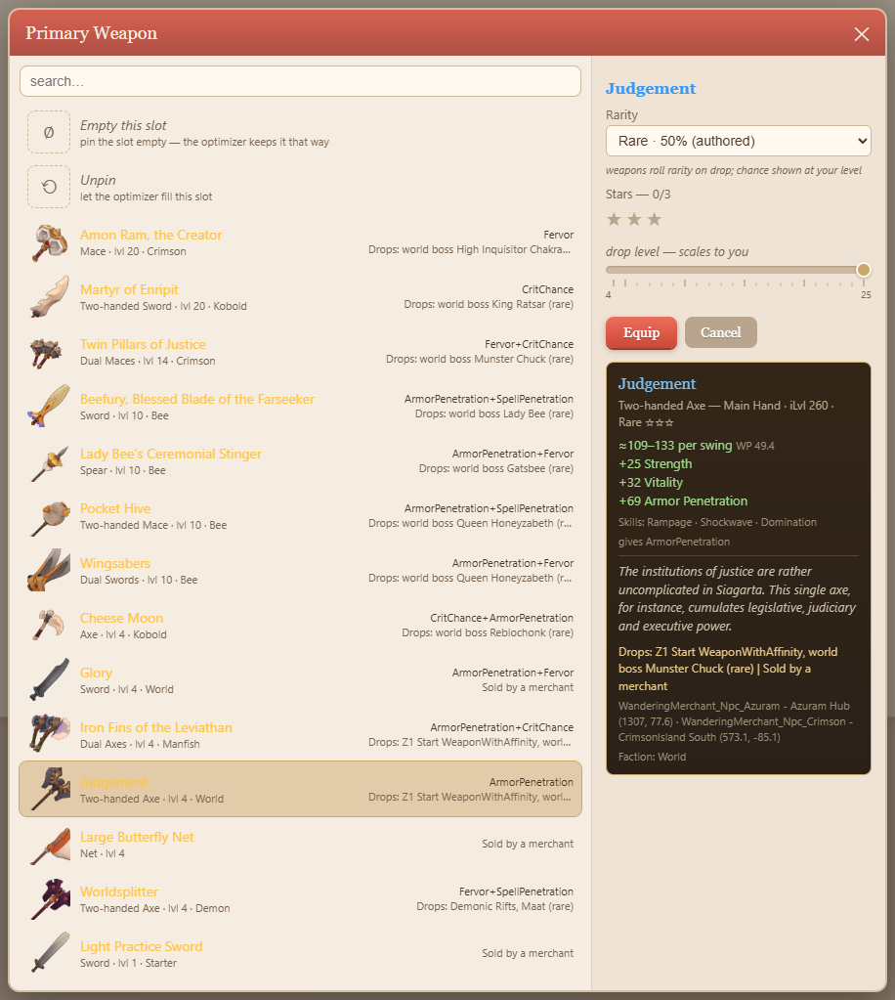
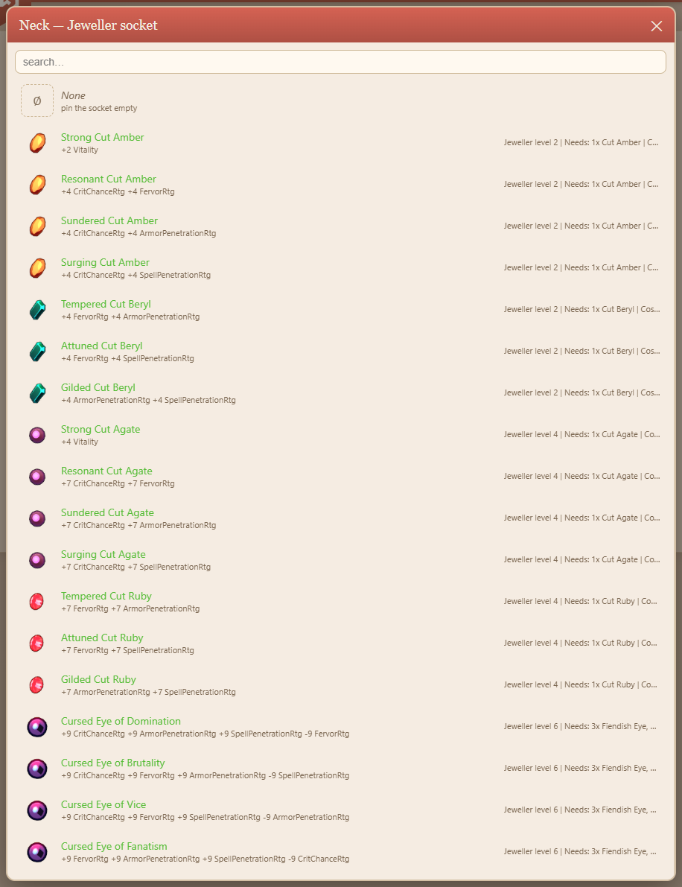
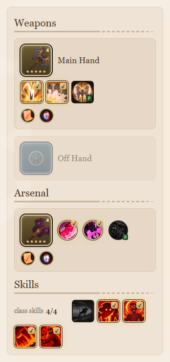
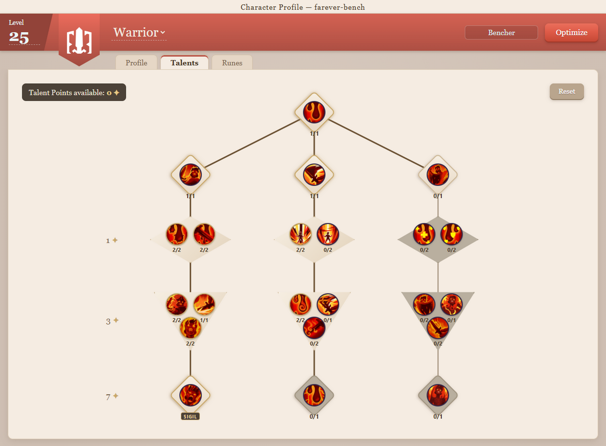
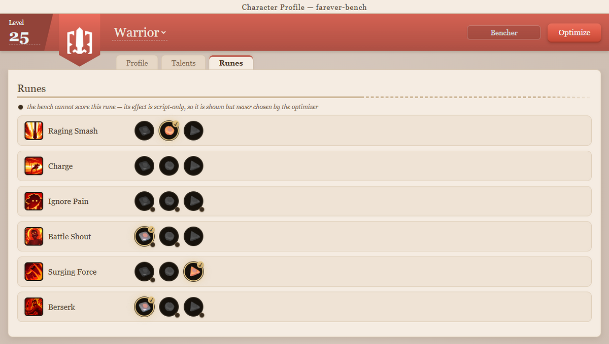
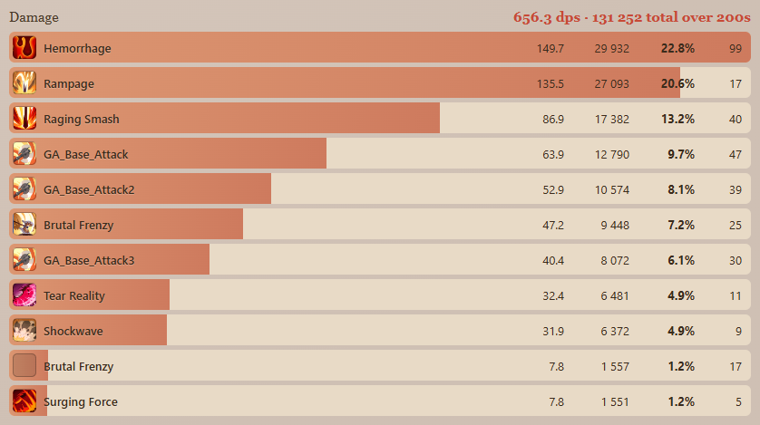

# farever-bench

A gear bench and damage simulator for **Farever** (Shiro Games). Every number
it prints comes out of `data.cdb` in your own installed copy of the game — and
in the UI, every icon comes out of your own `res.pak` — so the answers are your
game's answers, at the patch you are actually playing. Pin whatever you have
already decided — a weapon, a chest piece, an empty trinket slot — and it fills
the rest: every armour slot, both weapons, the offhand, all the enchant and gem
sockets, the talent tree, the runes, and the skills each weapon lets you slot.

**You need Farever installed**, whichever way you run it. Nothing game-derived
is redistributed here, so there is no standalone mode and no bundled database.



---

## Quick setup

| | what it needs | how you start it |
|---|---|---|
| **`FareverBench.exe`** — the desktop app | Windows 10+ x64. Nothing else to install: Node, the engine and the UI are inside it. It is **unsigned**, so SmartScreen says *"Windows protected your PC"* — click **More info** → **Run anyway**. | Double-click it. |
| **`bench ui`** — the same UI, in your own browser | [Node.js](https://nodejs.org/) 18+. Windows, Linux or macOS. No Chromium download and no signature dialog. | `bench ui --open` |
| **`bench <command>`** — the command line | [Node.js](https://nodejs.org/) 18+. Windows, Linux or macOS. | `bench optimize --class Warrior` |

The last two are the same download and the same source tree, so choosing
between them is a matter of taste, not of installing anything twice.

### The shortest path to a first result

**The desktop app.** Take `FareverBench-v<version>.exe` from
[Releases](https://github.com/Blaakan/farever-bench/releases), run it, click
past SmartScreen, pick a class, press **Optimize**. On first run it finds the
game through Steam's library list; if it cannot, it asks for the folder — the
one holding `Farever.exe` and `hlboot.dat` — and remembers the answer.

**The UI in your browser.** Take `farever-bench-v<version>.zip` from the same
place, unzip it, and from the folder it makes:

```bash
bench-ui            # Windows          (bench-ui.cmd)
./bench-ui.sh       # Linux, macOS
```

Either one is `bench ui --open` and nothing else: it starts a server bound to
`127.0.0.1`, opens your browser at it, and prints the URL. `--port <n>` pins
the port; `Ctrl+C` stops it.

**The command line.** Same zip, same folder:

```bash
bench optimize --class Warrior                  # Windows      (bench.cmd)
node bin/bench.mjs optimize --class Warrior      # Linux, macOS
```

Everything below writes `bench`; on Linux and macOS that is
`node bin/bench.mjs`. Cloning the repo works too — there is nothing to build
and nothing to install, because the tool has no runtime dependencies:

```bash
git clone https://github.com/Blaakan/farever-bench
cd farever-bench
node test/run.mjs                    # about 4,300 checks against your own game data, 40-55 minutes
node bin/bench.mjs optimize --class Warrior
```

`node test/run.mjs --list` prints the suite's group titles and `--only
"<regex>"` runs the groups whose title matches. A group that asserts
nothing fails, and a throw costs only its own group.

**The numbers are your patch's, and the tool says when it has not caught up
with it.** Every command opens with the fingerprint of the game files it
read. If that is not the build the model was last accepted on, the next line
says so:

```
this install is not the build the model was accepted on (2026-08-11) - run bench update
```

The numbers are computed either way; they are not vouched for until
[`bench update`](#two-more-commands) has been worked through. The UI carries
the same sentence as a strip across the page.

### Finding the game

Auto-detection reads Steam's own registry keys, which only exist on Windows.
Anywhere else — and on Windows when the library list is unusual — name the
folder:

```bash
bench optimize --class Warrior --game "E:\SteamLibrary\steamapps\common\Farever"
bench ui --open --game ~/.steam/steam/steamapps/common/Farever   # a Proton install
```

The path is remembered in `.cache/`, so you answer once. The packaged exe
unpacks to a fresh temp folder every launch and so keeps its answer in
`%APPDATA%\farever-bench-ui\settings.json` instead; run it with `--setup` to
change it.

Everything is read-only. The tool never touches the game process, writes
nothing to the install directory, and makes no network connection — with one
opt-in exception: handing it a [questlog.gg build
link](#importing-a-build-from-questloggg) fetches that build and pins it.

---

## What it simulates, stated plainly

A dps figure is only worth as much as the fight it was measured over, so the
fight is stated with every number rather than assumed. The defaults:

| | default | what it means |
|---|---|---|
| fight length | `--fight 200` | a 200-second fight, which is what a damage meter reports |
| target | `--target boss` | a **named boss** (ul'Serous, Herald Avatar: 40% / 40%) standing at your own level, immune to crowd control — not the training dummy, and not the game's own `Armor_ExpectedReduction` constant, which sits well under what you actually fight |
| target health | `--target-health 100` | it stands at **full** health, so every execute rider in the game is off |
| enemies hit | `--targets 1` | honest single-target: nothing scales with a crowd |
| weapon mastery | `--rank max` | rank 3 — a weapon you have finished. Every skill it grants, passives included, takes two upgrades |
| upgrade stars | `--stars max` | weapons at the most stars their rarity allows; armour has no upgrade path at all |

Four of those are the levers that move an answer most, and each is an **input**
rather than a derived number for a reason the data itself gives:

- **`--targets <n>`** — most of a build's damage is area-borne. The geometry is
  fully authored, shape and range and an expanding radius, but *nothing
  anywhere says how many enemies stand inside it*: placement is level data.
  This is the first flag to reach for when the tool's number looks low against
  an in-game meter.
- **`--target-health <pct>`** — eight script clauses across seven weapons
  compare the target's health against a threshold. Which phase of a fight you
  are asking about is not something a table can answer, so you say it, and the
  comparison is then answered exactly.
- **`--target <t>`** — `none | dummy | reference | trash | small | big | elite
  | boss | dungeon | heroic`, or any unit id. What penetration buys depends
  entirely on this: at 50% penetration, nothing against `none`, +5.3% on the
  training dummy, +25.0% against the default boss. Two things about that list
  changed with the September 30 update. **The training dummy is not a zero
  any more**: its row authors 40% armour and it stands at level 1, so a
  level-25 character loses about 10% on it; `none` is the target that
  mitigates nothing. And a target has a **level**: a unit id stands where its
  row puts it in Normal difficulty, `<unit>@veteran` and `<unit>@heroic` stand
  it at the level cap (Heroic also reads its heroic armour rows),
  `<unit>@scaled` builds its pool at your level as a rift does, and
  `--target-level <n>` overrides any of them. `bench targets` prints the
  whole ladder, heroic bosses included.
- **`--fight <s>`** — a 20-second pull and a 200-second one weight cooldowns
  completely differently. The default matches what a meter shows you.

Two more worth knowing: `--fights <n>` rolls the procs, the ±10% swing band
and the crit for real instead of folding them in at their expected rate, and
reports the mean and the spread; `--goal <g>` swaps the objective between
`dps`, `hps`, `sps`, `ehp` and `mixed`.

The damage column **adds up**: every ability's total sums to the overall, the
base-attack chain is broken out per link rather than hidden behind one row, and
HITS counts damage *events* — a dot's tick, each hit of a multi-hit cast, one
per target of a cleave — which is what a damage meter counts, so the two
reconcile row by row.

---

## The UI

The same page whether it arrived as an exe or through `bench ui`. Three tabs —
**Profile**, **Talents**, **Runes** — over a character sheet built to the
game's own layout, with the game's own icons and tooltips.

### The character sheet



Twelve armour slots down the middle in the game's visual order, attributes on
the left, weapons on the right. Click a slot to pick an item; right-click it to
unpin it again. A number in a slot's corner is the level the piece is
**priced at** — its instance level, which for a drop is yours and for a
crafted or authored piece is its row's — the stars under the icon are its
upgrade level, and the small disc at the bottom right is its socket — click
that instead and you are choosing the enchant or the gem rather than the item.

Every slot you touch becomes a **pin**: **Optimize** holds it and searches
around it. A slot you never touch is left free. Those are three different
states and the picker names all three — an item, *Empty this slot* (pinned
empty, and the optimizer keeps it that way), and *Unpin* (let the optimizer
fill it). One thing on a pinned piece can still be left to the search: its
**infusion** is pinned only when the picker states one (or states "none");
otherwise the optimizer chooses it.

The screenshots on this page were taken before the September 30 update. The
layout is the same; what they do not show is the Infusions block under the
sheet, the infusion controls in the picker and its *Not offered* list, all
described below.

The left column starts on the five primaries. **More stats** turns it over to
everything else — the same second page the game shows you, with the conversions
the game does not:



Armour carries its own reduction next to it (`1991`, `-40.8%`), because the
number alone means nothing without the target it was computed against.

### Picking an item



The list is every item legal in that slot for that class, at that level. The
right-hand pane is what you are about to equip, and the controls above it are
the things about an item that are not fixed by its row:

- **Rarity** — a weapon rolls its rarity when it drops, so the dropdown gives
  every rarity it can roll and the share of each *at your level*. Gear does
  not roll: its rarity is its row's, an Epic chest is a different item from
  the Rare one, and the dropdown says so.
- **Stars** — upgrade level. **Only weapons can be upgraded**; the game's own
  window text says so and the twenty `<WeaponType>_Upgrade` skills exist for
  weapon types only. Armour has no star row at all.
- **Drop level** — a weapon or a piece of armour that a kill generates takes
  the level of whatever dropped it, so the slider is which instance you are
  holding. Jewellery and crafted pieces keep the level on their row, and an
  Epic piece can only be made at the level cap, so its band is one level.
- **Infusion** — on a piece that can carry one (Epic armour with a faction),
  three more controls: which infusion — or *the optimizer's choice*, or
  *none* — which rating its bonus line rolled, and whether the piece is
  Prismatic. The list is the infusions something in your install hands out.
- **The tooltip** — the exact affix bake, the weapon's damage range and
  WeaponPower, the skills it grants, its faction, and **where it comes
  from**: the modkit atlas's coordinates when that file is present, otherwise
  what the install's own loot tables, merchants and recipes say.

The list ends with a **Not offered** section: rows nothing in your install
hands out (on the September 30 build, 26 Epic pieces that sit only in loot
tables nothing opens) and rows whose every copy is made above your level,
dimmed, each with the sentence that says why. You can still equip one. The
optimizer never picks one, and its result lists what it was not offered.

Sockets are their own picker, listing every augment the socket can host with
what each one pays and what crafting it costs:



### Weapons and the arsenal



Under each weapon are the skills it offers. A lit tile with a tick is slotted;
a dimmed one is not. **A weapon offers three skills and you get two**, so this
is a real build decision — click a tile to change it. A pool is held for the
optimizer only once your selection **fills** it, and a held pool wears a gold
pip; click the pip to hand the choice back. (Before that rule any click
pinned the pool, deselecting included, and the optimizer quietly returned
your own half-made selection.)

The **arsenal** is the second weapon. It contributes `ceil(stat × 0.4)` of its
stats and its two slotted skills, and nothing else: you do not swap to it, so
it brings no base-attack chain and no combo. That is checked against the game —
the same spear reads +36/+18/+15/+39/+39 in the main hand and +15/+8/+6/+16/+16
in the arsenal.

The tile marked **P** is a passive, and it is one of the pool's picks like any
other: **taking the arsenal's passive spends one of its two skill slots.** That
is the surprising part of the arsenal, so the badge is there to say it out
loud. A passive with no badge was granted rather than chosen, and costs
nothing.

### The talent tree



The real tree with the real rules. Left-click a node to spend a point,
right-click to take one back — and taking a point out of a node that another
one stands on empties what it fed, because the tier thresholds are counted the
way the game counts them: points spent **at lower tiers in that branch**, root
included, `t1=1 t2=2 t3=4 t4=8`.

The counter at the top left is what you have left to spend. A node badged
**SIGIL** was granted outright by a Demon sigil in your head slot: it costs no
point and does not count toward its branch's thresholds.

Touch any node and the whole allocation becomes a pin — a half-pinned tree is
not something the search can legally complete.

### The rune page



Every skill the build knows, with its three runes. Click one to slot it; click
it again to empty the slot.

A rune marked with a dot is one **the bench cannot score** — its effect lives
in a script rather than in a column, so it is shown and described but never
chosen by the optimizer. 31 of the 84 runes declare something readable (they
gate a step, suppress one, override a cooldown or charge count, or gate a stat
affix); the other 53 promise things that live in code. Slotting one by hand
still pins it, which is how you ask *what does the rest of the build look like
if I take this*.

### Optimize

Press **Optimize** and the search fills every slot and socket you did not pin,
picks the skills, allocates the tree, slots the runes, hands out infusions,
and plays a 200-second fight. It runs in a worker thread and streams progress
while it goes; a full class from nothing takes about three minutes (Warrior,
Mage), eight (Priest) and twelve (Rogue) on build 25959898, as timed for
this page one after the other on a machine that was running the suite and
two other searches beside them - alone each is quicker. The Priest's
is the one that grew: a build that holds Sunlight is played in several
orders (see [The fight](#the-fight)).

The **Infusions** block under the sheet is where the set layer is read and
steered. On your side it chooses what the optimizer may hand out (the lit
orbs) and what it takes an unowned piece's bonus roll to be. On the result it
shows the sets worn — pieces, the set rank reached — what of each set is in
the number, everything the set does that is NOT scored, folded under it, and
each piece's bonus line: lit, dark (and why), or not stated.

The answer arrives on a **second sheet beside yours**, marked `read-only`:


Nothing on the right can be edited — it is the search's answer, not a build in
progress — but every tooltip works, and its own **Profile / Talents / Runes**
tabs show what it chose in the tree and the rune page. **Apply to editor**
moves the whole thing to your side, where it becomes yours to change; **Save
build (.json)** writes the same envelope `--json` writes, which
`bench optimize --build <file>` reads back and reproduces exactly.

Under it, the damage meter, in the game's names and icons:



Per row: dps, total damage, share of the whole, and **hits** — damage events,
the same thing an in-game meter counts. `not modelled: 2 abilities` at the
bottom expands into what the model could not score and why, which is the part
of the answer worth reading before you trust the rest of it.

---

## The command line

| | |
|---|---|
| [`optimize`](#bench-optimize) | fill every unpinned slot and socket with the best combination |
| [`sheet`](#bench-sheet) | the stat sheet a build produces, with rating→percent conversions |
| [`rank`](#bench-rank) | rank every item that fits one slot against your current build |
| [`items`](#bench-items) | every item legal in a slot for a class |
| [`weapons`](#bench-weapons) | every mainhand, ranked at one stat corner |
| [`layouts`](#bench-layouts) | the best full build for every ordered (mainhand, arsenal) pair |
| [`rotation`](#bench-rotation) | search for the rotation a weapon wants, and the kit that goes with it |
| [`talents`](#bench-talents) | the talent trees and runes, and how much of them is readable |
| [`targets`](#bench-targets) | what the world actually resists, and what penetration buys |
| [`profiles`](#bench-profiles) | the stat corners a weapon or a rotation can be compared at |
| [`classes`](#bench-classes) | the playable classes and what they scale off |
| [`slots`](#bench-slots) | the slots, their share of the stat budget, and which augments they host |
| [`rarity`](#bench-rarity) | which rarities each slot can reach, and how that is derived |
| [`audit`](#bench-audit) | every assumption and gap in the model |
| [`ui`](#quick-setup) | the same sheet in your own browser |
| [`update`, `verify`](#two-more-commands) | the patch-day pipeline, and the model against a recorded capture |

Every command takes `--class`, `--level`, `--target`, `--fight`, `--goal`,
`--game` and the pins; `bench --help` prints the lot. A flag the command line
does not read is refused with the nearest names (`unknown flag --target-lvl -
did you mean --target-level?`) where it used to run the defaults in silence.
Every command prints its
provenance first — the tool's version, the fingerprint of the `data.cdb` and
`hlboot.dat` it read, and where it read them:

```
farever-bench 0.5.0
cdb bc7ee48e  boot c7173926  game E:\SteamLibrary\steamapps\common\Farever
```

That header is elided from the examples below. Long outputs are trimmed, and
the trim is marked `...`. Every sample on this page was regenerated on
2026-10-17 from the commands shown, on Farever build 25959898 (the second
hotfix after the September 30 update) at level 25; your numbers follow your
own install.

### Pinning

Pinning is the point. Anything you pin is held fixed and everything else is
optimised around it.

```bash
--pin chest=Chest_RManfish_Cle       # fix an item
--pin weapon1=Sword_Swarm*3          # fix an item at 3 upgrade stars
--pin trinket=none                   # force a slot empty
--pin feet/enchantfeet=none          # force one socket empty
--pin weapon1=Spear_Eruption@Epic    # a weapon at the rarity it rolled
--pin weapon1=Spear_Eruption^10*0    # the instance that dropped at level 10, unupgraded
--pin chest=Chest_EBee_Fig~Infusion_Bee_DPS/CritChance   # an infused piece
--no-augment weapon1                 # no augments at all on that slot
```

The grammar on an item is `id` `^instanceLevel` `@rarity` `*stars`
`~infusion`, every suffix optional but in that order, and `none` in place of
an item pins the slot empty. Slot and item names are matched loosely —
`chest`, `Chest`, `Slot_Chest` and `fingerleft` all work — and an ambiguous
name is an error that lists the candidates rather than a silent guess.

`@rarity` is for **weapons only**: only a weapon rolls one. Gear keeps its
row's rarity, so `--pin chest=Chest_RBee_Fig@Epic` is refused with the id of
the row that IS the Epic piece. With no `@rarity` on a weapon you get the
best the slot can reach, the same "assume the good version" default
`--stars max` already applies.

`~<infusion>` puts an infusion on a piece that can carry one (Epic armour
with a faction), by id or by name. `/<rating>` after it states the rating its
bonus line rolled, and a trailing `!` says the piece is Prismatic; `~none`
pins it not infused, and with no `~` part at all the search chooses the
infusion.

Three more pins are not gear:

```bash
--skills weapon1=GA_Craft_Skill1,GA_Craft_Skill2                # slot 2 of the 3 a weapon offers
--skills prayers=Smite,Life                                     # choose the prayer sequence
--rune Warrior_Berserk=Warrior_Berserk_M3                       # one rune slot; repeatable, =none empties it
--talent Warrior_Hemorrhage=1 --talent Warrior_Talent_Sever=1   # naming ANY node fixes the WHOLE tree
```

`--rune` is per slot: every other rune is still searched. `--talent` is not,
and cannot be — the tree has tier thresholds, and a half-pinned allocation is
not something the search can complete legally. Which is why the pair above is
two flags and not one: Sever is tier 1 in the Center branch and wants a point
below it, so pinning it alone is refused with the reason, not silently fixed
up. A wrong id in any of the three is an error that prints the ones that exist.

### `bench optimize`

Fill every unpinned slot and socket with the best combination.

```bash
bench optimize --class Warrior
```

```
Warrior 25 - maximising dps vs named boss (Ulserous: S 0.67/0.67)
upgrade stars: max for rarity   weapon mastery: rank 3, fully mastered   rarities: all   drop-rarity: rolled
withheld: 13 stat-bearing rows nothing in this install hands out (--include-all offers them; `bench audit` says how that was read)

SLOT           ITEM                                RAR        UPG    iLVL  FACTION  GIVES              INFUSION
Weapon1        Judgement                           Legendary  *****   370  World    ArmorPenetration                       rolled
Weapon2        Twin Pillars of Justice             Legendary  *****   370  Crimson  Fervor+CritChance                      rolled
OffhandWeapon  (empty)
Head           Visor of the Sea Titan              Epic               300  Manfish  ArmorPenetration   Overwhelming Tides
Neck           Necklace of Fracture                Uncommon           150  ArPen    ArmorPenetration
Shoulders      Jaws From Another World             Epic               300  Demon    Fervor             Balance of Justice
Chest          Cuirass of the Queenslayer          Epic               300  Bee      ArmorPenetration   Hive Venom
Back           Shroud of the Ancient King          Epic               300  Crimson  Fervor             Balance of Justice
Hands          Holy Crimson Gloves                 Epic               300  Crimson  Fervor             Balance of Justice
Waist          Shell Swimming Belt                 Epic               300  Manfish  ArmorPenetration   Overwhelming Tides
Legs           Mine Estrone's Safety Thigh Guards  Epic               300  Kobold   CritChance         Balance of Justice
Feet           Sabatons of the Golden Swarm        Epic               300  Bee      ArmorPenetration   Hive Venom
FingerLeft     Set Eye of Fracture                 Rare               260  ArPen    ArmorPenetration
Trinket        Raclette Pan                        Epic               300  Kobold   ArmorPenetration
FingerRight    Set Eye of Fracture                 Rare               260  ArPen    ArmorPenetration

INFUSION
  SET                 PIECES  RANK        SCORED
  Balance of Justice       4  2  (4) Set  +2.5 PhysicalMastery
                                          +2.5 MagicMastery
                                          +5 PhysicalMastery (Infusion_Crimson_DPS_Physical) and +5 MagicMastery (Infusion_Crimson_DPS_Magic), swapped every 10s in combat - one at a time, each up its share of the fight
  Hive Venom               2  1  (2) Set  Hive Venom (Infusion_Bee_DPS_Dot) on the foe: stacking to 5, applied on every status you land on the foe
  Overwhelming Tides       2  1  (2) Set  Wet (Infusion_Manfish_DPS_Status) on the foe: +2% DamageTakenModifier a stack, up to 3, one stack on every crowd control you try to apply and every knockback one of your hits applies
  Balance of Justice in this fight: +5 PhysicalMastery: up 50% of the fight; +5 MagicMastery: up 50% of the fight
  Hive Venom in this fight: Hive Venom: 100 ticks, 26.1 dps
  Overwhelming Tides in this fight: Wet: 2.99 of 3 stacks on the foe on average, up 100% of the fight, 145 applications
  bonus stat: 8 with no roll stated, priced at 0 (up to 65 rating if the faction-matched ones are lit)
  searched: 13 of 15 infusions; an unowned piece's bonus roll is priced at 0 (--infusion-stat best|<rating> to ask)
  withheld: Resine Armor - Queen Honeyzabeth drops it on Heroic only (loot table Cleodora_LT2), and Heroic is not released for Honeyzabeth’s Hivetrunk (heroicReleaseStatus Development, which $HData.checkStatus@21563 refuses)
  withheld: Honorable Defender - High Inquisitor Chakram drops it on Heroic only (loot table Phrixes_LT2), and Heroic is not released for Chakram's Chapel (heroicReleaseStatus Development, which $HData.checkStatus@21563 refuses)
  (--infusions all offers them anyway)

AUGMENTS
SLOT         SOCKET         AUGMENT                           EFFECT
Weapon1      EnchantWeapon  Magic Formula: Devote
Weapon1      Demon          Corrupted Gift                    -40 SpellPenetrationRtg +40 ArmorPenetrationRtg
Weapon2      EnchantWeapon  (none)
Weapon2      Demon          Corrupted Gift                    -40 SpellPenetrationRtg +40 ArmorPenetrationRtg
Head         DemonSigil     Sigil of Bet'Hatesht              grants Surge of Violence - a next-cast register
Neck         Jeweller       Cursed Eye of Brutality           +9 CritChanceRtg +9 FervorRtg +9 ArmorPenetrationRtg -9 SpellPenetrationRtg
...

TALENTS
  16 of 16 points spent, 1 granted by a sigil
  TIER  BRANCH  TALENT             RANK                    GIVES
  4     Left    Surge of Violence  from sigil              a next-cast register
  0     Root    Hemorrhage                                 35% of physical crits as a bleed
  1     Center  Sever                                      +20% crit damage on weapon skills
  1     Left    Seasoned Soldier                           +1 Rage per crit
  2     Left    Bloodletting       2/2                     +20% damage on bleeds
  3     Left    Bruise                                     +4% damage physical
  2     Left    Exsanguination     2/2                     +20% crit chance on bleeds
  3     Left    Master-at-arms     1/2                     +15% crit damage attack-or-combo
  1     Right   Rage Shield                    gate point  nothing readable
  2     Right   Bloodfeast         2/2                     +30% of it healed back on bleeds
  3     Right   Hold the Line      2/2                     status
  3     Right   Zealous Warrior    2/2                     +4 Fervor

SKILLS
POOL              SLOTS  TAKEN
main-hand skills  2/2    Rampage, Shockwave                            always on: Domination
arsenal skills    2/3    Iron Cyclone, Zeal                            not taken: Zealous Spins
class skills      4/5    Charge, Battle Shout, Surging Force, Berserk  not taken: Ignore Pain

not scored in this build (5) - --verbose for what and why

RUNES
  SKILL          SLOTTED              READABLE  WHAT IT CHANGES
  Raging Smash   Scent of Battle      3/3       changes its cost
  Charge         Juggernaut           3/3       +5 Rage
  Ignore Pain    (none)               0/3
  Battle Shout   Battle Fury          1/3       nothing this model can read
  Surging Force  Concentrated Impact  2/3       +40% damage at one target
  Berserk        Releasing the Beast  1/3       overrides cooldown
...

Primary
  attribute  value
  Strength     195
  Dexterity     46
  Intellect     28
  Faith         28
  Vitality     249

Offence
  attribute                value
  WeaponPower              49.43
  CritChanceRating            84  -> CritChance 4.42pp   +1 = +0.0526pp
  CritChance               14.46
  CritDamage              154.46
  ArmorPenetrationRating     479  -> ArmorPenetration 63.05pp   +1 = +0.1316pp
  ArmorPenetration         63.05
...

DAMAGE
                               DPS   DAMAGE  SHARE  HITS
  overall                    841.7  168,339          512
  Hemorrhage                 181.8   36,360  21.6%   100
  Rampage                    168.2   33,641  20.0%    13
  Iron Cyclone               124.1   24,813  14.7%    76
  Raging Smash               107.4   21,477  12.8%    45
  Brutal Frenzy (filler)      52.0   10,395   6.2%    29
  GA_Base_Attack              43.0    8,609   5.1%    49
  Shockwave                   42.7    8,533   5.1%     8
  GA_Base_Attack2             29.0    5,800   3.4%    33
  GA_Base_Attack3             27.1    5,418   3.2%    31
  Hive Venom                  26.1    5,224   3.1%   100
  Charge                      22.3    4,454   2.6%    13
  Brutal Frenzy (triggered)   10.9    2,181   1.3%    10
  Surging Force                7.2    1,435   0.9%     5
```

Four things in that output arrived with the September 30 update, and each is
a statement about what the number does and does not contain:

- **`withheld:`** — rows the item sheet authors and nothing in your install
  hands out are not offered. `--include-all` offers them; `bench items`
  prints each one's reason.
- **The INFUSION block.** An infusion is a set passive on a piece of Epic
  faction armour, and its rank is the count of pieces carrying the SAME one
  against 2 / 4 / 6. `SCORED` is what of each set is in the number, one row
  per part, followed by what that part came to in this fight. When a set
  also does something NOT scored, a line under it counts those sets and
  `--verbose` names what is left out; none of these three does.
- **`bonus stat: ... priced at 0`.** An infused piece also rolls a bonus
  rating when it is looted. Nobody owns the pieces a search invents, so the
  roll is not assumed: `--infusion-stat best` or `--infusion-stat CritChance`
  asks what it would be worth, and a pin states one outright.
- **What an infusion does is read; when it fires is partly measured; how
  much it deals is not.** None of the four captured characters wears one.
  Other players in the same log do - 9,657 rows of 20 infusion statuses and
  steps from 33 of them, with no build, sheet or set rank behind them. Those
  rows settle when three sets fire and how often (Seals of Atonement once
  per damage instance of the wearer's own swings, Hive Venom's two-second
  clock and its stacks, Fermentation one stack per damage instance of a
  weapon skill) and no amount. `bench audit` has an entry per priced set
  with its counts and the reading that would settle the rest.

One line of that output is a correction the first capture on this build
forced: `Weapon2 EnchantWeapon (none)`. An enchant is a skill its formula
grants, and the weapon in your arsenal hands out no skill from its sockets.
READ: `st.item.Gear.getSkills@9762` skips its first loop for a piece in
`Slot_Weapon2` (ops 4-6) and runs its second only when `canGiveSlotSkills`
holds (ops 76-79), which `st.item.Weapon.canGiveSlotSkills@9839` answers
false for the hero's secondary weapon (the numbers of build 25959898). MEASURED 2026-10-13: a Rogue with
Devote in her arsenal daggers logged not one Devote stack in 15,489 damage
rows, beside 1,531 Flaming Weapon hits from her main hand. The stat lines of
a socketed augment are affixes and still count, which is why Corrupted Gift
stays in the arsenal's Demon socket. Until then the search had put a second
enchant there and priced it.

In TALENTS, `gate point` tags a node the bench cannot read and the
allocation cannot lose: a tier it took stands on that point. A point in an
unreadable node that nothing stands on is handed back rather than spent
blind - the default Mage search prints `14 of 16 points spent, 2 unspent` -
and `bench talents` says both.

`--infusions learnable|all|none|<list>` says which infusions the search may
hand out (the default leaves out the ones your install shows to be
unobtainable), and `--tick-source instigator|carrier` switches whose Fervor,
mastery and crit a status tick takes — the unit that applied it, which is
what this build's code reads, or the unit wearing it, which is what the
previous build measured.

`--verbose` adds back everything that *explains* a number rather than being
one: the search trace, the rotation and its reasoning, the cause of every
refusal, the talent coverage note, and the assumptions-and-gaps list. `--json
<file>` writes the whole envelope, and `--build <file>` reads it back and
reproduces the run — its recorded goal, target, level, fight and pins become
the defaults, so a saved build is a starting point as well as a record.

### `bench sheet`

The stat sheet a build produces, with the rating→percent conversions.

```bash
bench sheet --class Warrior --pin weapon1=GA_Craft
```

```
SLOT           ITEM       RAR        UPG    iLVL  FACTION  GIVES
Weapon1        Judgement  Legendary  *****   370  World    ArmorPenetration  rolled
Weapon2        (empty)
...

SKILLS
POOL              SLOTS  TAKEN
main-hand skills  2/2    Rampage, Shockwave                                always on: Domination
class skills      4/5    Charge, Ignore Pain, Battle Shout, Surging Force  not taken: Berserk

not scored in this build (3), by cause:
  conditional  it procs, but only while something this reader cannot evaluate holds
    Rampage (GA_Craft_Skill1)
  gated off  its script gates it on a rank or a talent this build does not have
    Ignore Pain (Warrior_IgnorePain#SelfHeal)
  off against this target  read and correctly worth zero against this target - a stunnable one moves it
    Domination (GA_Craft_Passive)
      Domination is read, and its clause is worth zero here: dmgMult +0.25 on every hit against a crowd-controlled target, and this target is immune to crowd control (unit flags: Boss) - nothing this build casts can put it in that state

Primary
  attribute  value
  Strength      88
  Dexterity     28
  Intellect     28
  Faith         28
  Vitality     108
...

METRIC                        VALUE
damage / s                    141.3  <- goal
healing / s                     0.0
shielding / s                   0.0
effective HP                  1,174
  physical / magical  1,174 / 1,174  reduction 0.0% / 0.0%
time on cooldowns             38.0%  62.0% swinging, 0.1% idle
fight                          200s  one 200s fight, procs at their expected rate

ROTATION   attacks 0.66/s, combos 0.17/s
  played both ways over a 8s lookahead and kept the better: priority order 141.3, sequenced 140.5 - nothing here rewards ordering, so priority order stands
  SKILL            KIND       PER CAST    EVERY  SHARE
  Rampage          active        764.8   15.38s    20%
  Brutal Frenzy    filler        111.2    5.71s    15%
  GA_Base_Attack   filler         54.5    4.00s    19%
  Raging Smash     active        107.0    8.00s     5%
  Shockwave        active        313.9   25.00s     4%
  GA_Base_Attack2  filler         54.3    4.55s    15%
  GA_Base_Attack3  filler         54.4    5.41s    13%
  Charge           active         80.2   15.38s     7%
  Brutal Frenzy    triggered      68.8   17.14s         Brutal Frenzy's Attack step is played on the combo finisher, once for every hit the swing lands, 25% of the time - and again on its own hit, which rolls the same chance
  ...
```

The unscored list is grouped by **cause**, and three of the causes are not
gaps at all: `off against this target`, `off at this target health` and
`off in this build` are things the tool read, answered, and found worth zero
for the fight you described — with what would switch each on printed under
it. Here Domination's rank-3 bonus needs the target to be crowd-controlled
and the default boss cannot be; `--target dummy` moves it.

Nothing is searched here: `sheet` evaluates exactly the build you describe,
which makes it the command to reach for when you want to know what one specific
set of gear does — and, run twice with one pin changed, what that change is
worth. `METRIC` is every goal at once, so a dps run still tells you what it cost
you in effective health.

### `bench rank`

Rank every item that fits one slot, against your current build.

```bash
bench rank --class Warrior --slot chest --pin weapon1=GA_Craft
```

```

Warrior 25 - ranking Chest by dps vs named boss (Ulserous: S 0.67/0.67)

  ITEM                      RAR       ROLL  UPG  FACTION  GIVES                                DPS    DELTA
  Chest_EBee_Fig            Epic                 Bee      ArmorPenetration                   156.7  +10.89%
  Chest_RBee_Fig            Rare                 Bee      ArmorPenetration                   153.3   +8.52%
  Chest_RCrimson_Fig_Craft  Rare                 Craft    ArmorPenetration                   149.9   +6.11%
  Chest_ECrimson_FigCle     Epic                 Crimson  Fervor                             149.5   +5.83%
  Chest_EKobold_FigAss      Epic                 Kobold   CritChance+ArmorPenetration        148.9   +5.36%
  Chest_EManfish_FigWiz     Epic                 Manfish  ArmorPenetration+SpellPenetration  148.5   +5.15%
  Chest_EDemon_FigCle       Epic                 Demon    Fervor+SpellPenetration            148.3   +4.95%
  Chest_RCrimson_FigCle     Rare                 Crimson  Fervor                             148.2   +4.87%
  Chest_RManfish_FigWiz     Rare                 Manfish  ArmorPenetration+SpellPenetration  147.4   +4.31%
  Chest_RDemon_FigCle       Rare                 Demon    Fervor+SpellPenetration            147.1   +4.15%
  ...

... 14 more (--all to see them)
```

The Epic chest and the Rare one of the same family are two rows of the
ranking, because they are two items: gear does not roll a rarity. The `ROLL`
column is filled on a weapon slot, where one weapon is one row per rarity a
drop at your level can come out as, with its share (`--slot weapon2`:
Legendary 1%, Epic 27%).

Every row is the whole objective re-evaluated with that item equipped, not a
stat weight — see [why not stat weights](docs/MODEL.md#why-not-stat-weights).

### `bench items`

Every item legal in a slot for a class.

```bash
bench items --class Warrior --slot chest
```

```


Chest_C_BaseClothes       White Shirt                           Common                0     (scales)  -        -                                          -
Chest_Starter_Fig         Squire's Brigandine                   Common                0   25 (row 1)  -        -                                          -
Chest_Z1U1_Fig            Reinforced Hauberk of the Exile       Uncommon              0   25 (row 2)  -        -                                          -
Chest_Z1U2_Fig            Reinforced Hauberk of the Trespasser  Uncommon              0   25 (row 8)  -        -                                          -
Chest_RBee_Fig            Whirring Gem of Apix                  Rare                  0     (scales)  Bee      ArmorPenetration                           -
Chest_EBee_Fig            Cuirass of the Queenslayer            Epic                  0     (scales)  Bee      ArmorPenetration                           CritChance/Fervor/SpellPenetration
Chest_RCrimson_Fig_Craft  Scarlet Breastplate                   Rare                  0           20  Craft    ArmorPenetration                           -
...
Chest_RKobold_FigAss      Cantal Goya's Breastplate             Rare                  0            6  Craft    ArmorPenetration+CritChance                -
Chest_EKobold_FigAss      Breastplate of Chuck "No Rice"        Epic                  0     (scales)  Kobold   CritChance+ArmorPenetration                Fervor/SpellPenetration
...
Chest_RManfish_FigWiz     Fin Armor                             Rare                  0     (scales)  Manfish  ArmorPenetration+SpellPenetration          -
Chest_EManfish_FigWiz     Warplate of the Meropsian Reef        Epic                  0     (scales)  Manfish  ArmorPenetration+SpellPenetration          CritChance/Fervor
...
Chest_RCrimson_FigCle     Breastplate of Recklessness           Rare                  0     (scales)  Crimson  Fervor                                     -
Chest_ECrimson_FigCle     Vestplate of the First Zealot         Epic                  0     (scales)  Crimson  Fervor                                     CritChance/ArmorPenetration/SpellPenetration
...
Chest_RDemon_FigCle       Soul Visage                           Rare                  0   25 (row 1)  Demon    Fervor+SpellPenetration                    -
Chest_EDemon_FigCle       Chaotic Embrace                       Epic                  0   25 (row 1)  Demon    Fervor+SpellPenetration                    CritChance/ArmorPenetration

LVL: the level an unpinned piece is priced at. "N (row n)": the row authors level n and the piece is priced at N - a weapon or worn armour as a drop at yours, its row level being a floor, or a piece every source of which makes it higher (--drops authored prices a drop at n; --pin <slot>=<item>^n names one instance).

INFUSE: the ratings the piece's infusion bonus can roll (the ones it does not already pay).
```

`GIVES` is the item's secondary stat, and it is decided by the **faction**, not
by the item: the same Manfish chest gives a Priest Fervor and a Warrior
ArmorPenetration out of one data row. Gear with no faction has no secondary
stat at all.

`INFUSE` marks the pieces that can carry an infusion — Epic armour with a
faction — with the ratings its bonus line can roll. A `SOURCE` column
appears when nothing in your install hands a row out, with the reason
printed under the table: the tool reads the loot tables, the level files
inside the paks and the compiled code to say so, and a row it cannot judge
is offered, not withheld. No chest is withheld on build 25959898, so the
column is absent above; on 25782799 two were, the Epic chests of the Heroic
loot tables of Munster Chuck and Robin Hoof, whose dungeons the hotfix
opened. On a weapon slot `ROLL` carries the share of each rarity.

`LVL` is the level the piece is priced at, not the one its row authors. A
weapon and a piece of worn armour stand at the level of the drop, with the
row's level as a floor, so a row that authors level 1 prints `25 (row 1)` on a
level-25 character; `(scales)` marks a row that authors none. The 2026-10-13
capture holds it for armour (eight Demon armour rows that author level 1 were
logged at 25 or 24). Jewellery is priced at its row's level, which is an
assumption the same capture does not hold - two necklaces that author 15 were
logged at 17 - and `bench audit` carries both numbers.

### `bench weapons`

Every mainhand, ranked at one stat corner.

```bash
bench weapons --class Warrior --profile armorpen
```

```
Warrior 25 - every mainhand, ranked by dps vs named boss (Ulserous: S 0.67/0.67)
profile: ArmorPenetrationRating at 100  - every stat pinned to 50, ArmorPenetrationRating to 100
  pinned: Strength 50   Dexterity 50   Intellect 50   Faith 50   Vitality 50   Armor 50   MagicArmor 50   CritChanceRating 50   ArmorPenetrationRating 100   SpellPenetrationRating 50   FervorRating 50
  ! these stats are pinned to flat values, not earned from gear - the number is a comparison between builds on the same rig, never a dps anyone will read in game
14 weapons in 88.2s   weapon mastery: rank 3   skills, talents and runes chosen per weapon   arsenal: searched   no armour, no offhand, no augments

  DPS  VS BEST  WEAPON                                   HANDS       CHAIN  SLOTS  SKILLS TAKEN                          GAPS
245.8     0.0%  Judgement                                THWeapon    4      2/2    Rampage, Shockwave                    3
233.7    -4.9%  Wingsabers                               DualWeapon  5      2/2    Hiveborn Blossom, Swarmstrike Accord  2
217.6   -11.4%  Twin Pillars of Justice                  DualWeapon  4      2/2    Zealous Spins, Iron Cyclone           5
211.8   -13.8%  Pocket Hive                              THWeapon    4      2/2    Reverse Honey Spin, Brood Leap        5
206.5   -16.0%  Iron Fins of the Leviathan               DualWeapon  5      2/2    Abyssal Fury, Groundswell Strike      3
184.6   -24.9%  Worldsplitter                            THWeapon    4      2/2    Tear Reality, Dark Gift               3
181.4   -26.2%  Lady Bee’s Ceremonial Stinger            LongWeapon  4      2/2    Stingerang, Apix Dash                 6
174.1   -29.2%  Beefury, Blessed Blade of the Farseeker  OHWeapon    4      1/1    Hive's Sunder                         2
173.0   -29.6%  Cheese Moon                              OHWeapon    4      1/1    Bonethrow                             2
166.7   -32.2%  Martyr of Enripit                        THWeapon    4      2/2    Wild Whirlwind, Outburst              4
158.5   -35.5%  Light Practice Sword                     OHWeapon    4      1/1    Cleave                                1
156.7   -36.3%  Amon Ram, the Creator                    OHWeapon    4      1/1    Ram Veil                              4
155.1   -36.9%  Glory                                    OHWeapon    4      1/1    Conquer                               5
 78.0   -68.3%  Large Butterfly Net                      THWeapon    0                                                   2

NOT SCORED (27) - what these weapons declare that the model cannot price
  Rampage  Rampage's own damage IS scored; what is not is the cooldown it gives Shockwave - its script resets Shockwave's cooldown from an onKill hook, an event this fight does not produce, so Shockwave comes back slower here than in game
  Domination  Domination is read, and its clause is worth zero here: dmgMult +0.25 on every hit against a crowd-controlled target, and this target is immune to crowd control (unit flags: Boss) - nothing this build casts can put it in that state
  ...
```

`CHAIN` is the number of links the weapon's own row lists, finisher included,
and nothing pads it: Twin Pillars of Justice plays 4 where its weapon class
declares 5, because nothing in the September 30 build reads that length any
more. The run says so on the weapon's own line under `NOT SCORED`.

The `--profile` is the point of this command and is explained
[below](#comparing-weapons-without-the-gear-in-the-way): it pins every stat to
a flat number so two weapons differ only in the kit they grant and the
coefficients they scale by, never in which is the better stat stick.
`--across` re-runs the ranking at every corner and reports how far it moves.

### `bench layouts`

The best FULL build for every ordered (mainhand, arsenal) pair.

Where `weapons` compares mainhands on a bare rig, `layouts` gives each pair a
**whole build** — armour, offhand, augments, arsenal skills, talents and runes
searched per pair — and ranks the results. It is the expensive one.

```bash
bench layouts --class Warrior --main GA_Craft --restarts 1 --show 1
```

```
Warrior 25 - the best full layout for every ordered (mainhand, arsenal) pair, by dps vs named boss (Ulserous: S 0.67/0.67)
  1 mainhands x 18 arsenals = 17 pairs, each a full optimize (1 restart) over armour, offhand, augments, arsenal skills, talents and runes
  reports land in bench-layouts-Warrior-dps/ as they finish - index.json is the ranking so far, each pair file reloads with --build, and an existing file resumes instead of recomputing

  DPS  VS BEST  MAIN HAND  OFFHAND  ARSENAL                                  ARSENAL SKILLS                                       TALENTS
841.7     best  Judgement  -        Twin Pillars of Justice                  DM_Multispin_Skill2, DM_Multispin_Passive            12 nodes
783.7   -6.90%  Judgement  -        Martyr of Enripit                        GS_Nova_Skill1, GS_Nova_Passive                      12 nodes
746.7  -11.29%  Judgement  -        Worldsplitter                            GA_Demon_Skill1, GA_Demon_Skill2                     11 nodes
724.6  -13.92%  Judgement  -        Wingsabers                               DS_Bladeleaf_Skill1, DS_Bladeleaf_Passive            11 nodes
708.3  -15.85%  Judgement  -        Cheese Moon                              Axe_Boomerang_Skill1, Axe_Boomerang_Skill_Passive    12 nodes
699.5  -16.90%  Judgement  -        Beefury, Blessed Blade of the Farseeker  Sword_Swarm_Skill1, Sword_Swarm_Passive              12 nodes
698.5  -17.01%  Judgement  -        Iron Fins of the Leviathan               DA_Water_Skill1, DA_Water_Skill2                     12 nodes
697.4  -17.14%  Judgement  -        Pocket Hive                              GM_MassGrab_Skill2, GM_MassGrab_Passive              13 nodes
692.4  -17.74%  Judgement  -        Light Practice Sword                     Sword_Start_Skill1                                   13 nodes
675.9  -19.70%  Judgement  -        Lady Bee’s Ceremonial Stinger            Spear_Goo_Skill1, Spear_Goo_Passive                  12 nodes
660.5  -21.52%  Judgement  -        Rough Shield                             Shield_Start_Skill1                                  11 nodes
639.9  -23.97%  Judgement  -        Glory                                    Sword_Craft_Skill1, Sword_Craft_Passive              12 nodes
633.2  -24.77%  Judgement  -        Dominion                                 Shield_Craft_Skill1, Shield_Craft_Passive            12 nodes
620.5  -26.28%  Judgement  -        Large Butterfly Net                      -                                                    11 nodes
613.7  -27.09%  Judgement  -        Crabgantua's Kneecap                     Shield_OrbitWater_S1, Shield_OrbitWater_P            13 nodes
603.7  -28.27%  Judgement  -        Amon Ram, the Creator                    Mace_Benediction_Skill1, Mace_Benediction_Passive    12 nodes
568.2  -32.49%  Judgement  -        Magma Mia                                Shield_Firebreath_Skill1, Shield_Firebreath_Passive  12 nodes
  17 of 17 pairs legal, 2979.8s

==============================================================================
Judgement  +  Twin Pillars of Justice (arsenal)   dps 841.7
==============================================================================

SLOT           ITEM                                RAR        UPG    iLVL  FACTION  GIVES              INFUSION
Weapon1        Judgement                           Legendary  *****   370  World    ArmorPenetration                       pinned
Weapon2        Twin Pillars of Justice             Legendary  *****   370  Crimson  Fervor+CritChance                      pinned
OffhandWeapon  (empty)
Head           Visor of the Sea Titan              Epic               300  Manfish  ArmorPenetration   Overwhelming Tides
Neck           Necklace of Fracture                Uncommon           150  ArPen    ArmorPenetration
Shoulders      Jaws From Another World             Epic               300  Demon    Fervor             Balance of Justice
Chest          Cuirass of the Queenslayer          Epic               300  Bee      ArmorPenetration   Hive Venom
...
```

That run was 17 pairs at the cheapest setting and took fifty minutes, with the
full suite and two other searches running on the same machine. Each pair is a
full optimize: a search that also plans infusion sets plays 1.2 to 2 times
the fights it did before the September 30 update, and a Priest's, which plays
a build holding Sunlight in several orders, about four fights an evaluation
where it played one. Its best pair is the default optimum above, 841.7. Drop
`--main` and it sweeps every mainhand too, which on the Warrior is 14 × 18.
Which is why **every report is written to disk as it finishes**: the default
`bench-layouts-<class>-<goal>/` (moved with `--out <dir>`) holds one JSON per
pair plus a live `index.json`, re-running skips pairs already on disk, and a
crash or a `Ctrl+C` resumes instead of restarting rather than losing the
afternoon. `--fresh` recomputes, `--arsenal` narrows the other half,
`--restarts <n>` trades depth for time (default 3), `--show <n>` prints the top
layouts in full, and any pair file reloads into a normal run with `--build`.

### `bench rotation`

Search for the rotation a weapon wants, and the kit that goes with it.

```bash
bench rotation --class Warrior --profile armorpen \
  --pin weapon1=GA_Craft --pin weapon2=GA_Demon --restarts 60 --across
```

```
Warrior 25 - searching for a rotation, maximising dps vs named boss (Ulserous: S 0.67/0.67)
profile: ArmorPenetrationRating at 100  - every stat pinned to 50, ArmorPenetrationRating to 100
  ...
main hand GA_Craft   arsenal GA_Demon
1167525 simulated fights in 1306.5s over 3 rounds of (rotation, then kit)
1697752 lists considered - 530227 of them were lists this search had already played, and were re-scored from the memo

ROTATION  - walk it top to bottom, press the first line that is ready
  #   SKILL          WHEN                                         PER CAST    EVERY
  1   Dark Gift      cd.Surging Force<=1                               0.0   33.33s
  2   Berserk        cd.Rampage<=0.5                                   0.0   66.67s
  3   Raging Smash   buff.Battle Shout.up                             86.2    7.14s
  4   Shockwave      always                                          287.7   20.00s
  5   Rampage        always                                          918.5   13.33s
  6   Battle Shout   ready.Tear Reality                                0.0  100.00s
  7   Dark Gift      debuff.Tear Reality.remains>=0.5 & rage>=10       0.0   33.33s
  8   Surging Force  debuff.Tear Reality.down                         45.5   40.00s
  9   Tear Reality   always                                          369.4   18.18s
  10  Raging Smash   holding.Dark Gift                                86.2    7.14s
  11  Charge         debuff.Tear Reality.remains>=1                   69.7   18.18s
  12  Dark Gift      cd.Tear Reality<=3                                0.0   33.33s
  anything not listed is never pressed; when no line matches, you swing.

WHAT IT IS WORTH
                                                      DPS  VS DERIVED
  derived order (what every other command reports)  210.1
  searched rotation                                 234.7      11.69%
  ROUND  SEARCHED    DPS  FIGHTS
  1      rotation  223.8  378670
  1      kit       225.8
  2      rotation  231.6  371827
  2      kit       232.9
  3      rotation  234.7  417028
  3      kit       231.9

AND WHETHER IT SURVIVES THE DICE  - 200 fights each, procs and crits rolled rather than averaged
                       MEAN        SD
  derived order       210.0      5.13
  searched rotation   234.3      4.03
  difference         +24.33  +/- 0.46  clears the noise

AND WHETHER IT TRANSFERS  - the same rotation, re-evaluated at other stat corners
  PROFILE                 DERIVED  THIS ROTATION    GAIN
  zero                      107.2          100.9  -5.88%  LOSES to the derived order
  mid                       205.6          229.6  11.68%  holds
  crit                      209.8          225.2   7.34%  holds
  armorpen  (tuned here)    210.1          234.7  11.67%  holds
  fervor                    210.1          234.7  11.68%  holds
  A rotation that only wins where it was tuned is a rotation for that corner.
  One that holds everywhere is a rotation for the weapon, which is the thing worth having.

  18 of 60 independent restarts reached this score; worst reached 222.7.
```

Three things are checked rather than claimed, and they are the three lines
above: what the list is worth against the order the model derives, whether the
difference survives rolling the dice for real, and whether it transfers to
other stat corners. The rotation is followed by the kit it was searched
alongside — the talent allocation, the skills, the runes — because the two were
optimised against each other, in alternating rounds, until neither moved.

The gain is **+11.7%** here, where the same command found +2.9% before the
September 30 update. Two lines of the list suggest why, and they are offered
as a reading of the list, not as a measured decomposition: `Shockwave`
(line 4) sits above `Rampage` (line 5), so when both are ready the stun goes
first, and on this build a stun arms a register on Judgement's passive that
the next weapon skill spends as a certain critical strike; which weapon
skill follows the stun is the kind of decision a derived priority order
cannot make. The search ran three rounds this time, and in two of them the
kit round moved the number the rotation round had reached.

This list does NOT hold everywhere: at the `zero` corner, where nothing is
statted, it loses 5.9% to the derived order, so by the output's own closing
line it is a rotation for the corners with stats on them, not for the weapon.
The restart count is worth reading twice: **18 of 60**. A richer vocabulary
and a mechanic that rewards ordering make the basin around the best list
narrower, not wider — which is exactly why the search kicks the incumbent
instead of restarting at random. `--across-search` asks the stronger
question and is described [below](#searching-a-rotation).

### `bench talents`

The talent trees and runes, and how much of them is readable.

```bash
bench talents --class Warrior
```

```
Warrior - 22 nodes, 19 this model can read, 16 points at level 25
  TIER  BRANCH  TALENT               READS AS                                                              WHAT
  0     Root    Hemorrhage           35% of physical crits as a bleed                                      its script - no affix, effect or Status step in the row
  1     Left    Seasoned Soldier     +1 Rage per crit                                                      its script - no affix, effect or Status step in the row
  2     Left    Bloodletting         +10% damage on bleeds                                                 its script - no affix, effect or Status step in the row
  ...
  3     Left    Master-at-arms       +15% crit damage attack-or-combo                                      its script - no affix, effect or Status step in the row
  4     Left    Surge of Violence    a next-cast register                                                  its script - no affix, effect or Status step in the row
  1     Center  Sever                +20% crit damage on weapon skills                                     its script - no affix, effect or Status step in the row
  ...
  3     Center  Exposed Essence      +5% magic armour ignored vs bleeding, +5% armour ignored vs bleeding  its script - no affix, effect or Status step in the row
  ...
  1     Right   Rage Shield          nothing                                                               Hold the Line needs it; no affix, no effect, no status
  ...
  3     Right   Hold the Line        status                                                                only while Rage Shield is up; Warrior_Talent_HoldTheLine_Status x1
  ...

RULES   every one of them out of the data
  tier thresholds  t0=0  t1=1  t2=2  t3=4  t4=8
                   points needed AT LOWER TIERS in that branch, root included
  unlock level     10
  points at cap    16   (observed - no constant declares the rate)
  points per node  1 or 2 - props.talent.maxPoints, and it is 2 on 48 of 88
  DemonSigil       grants one tier-4 talent outright: costs no point, and does
                   not count toward its branch thresholds

WHY THIS IS MOSTLY STRUCTURE
  62 of 88 talent nodes declare something this model reads - a stat affix,
  a self-buff status, a damage effect, or one of the script shapes the fight
  plays (a scoped modifier, a pool, a status on a named event, a rider on a
  status's own hits, cooldown handed to a named skill). The other 26 read as
  nothing here: 25 of them ship an hscript body the readers behind this
  table do not take (the fight scores a few of those through readers of
  its own - a next-cast register, the Mage's chain), and the rest declare
  nothing at all. So what is left of the talent layer is blocked on script
  shapes, not on absent data. Every one of the 88 nodes also carries a
  texts.desc to check an implementation against.
  ...

  Runes are the same shape. 28 skills offer a choice, 84 runes in all, and 31 of them
  declare something this model reads:
     17  gate a step        steps[].cond.mastery
      1  suppress a step    steps[].cond.masteryExclude
      9  override a prop    mastery[].props (charges, cooldown)
      5  gate a stat affix  affixes[].conds.mastery
```

`WHAT` says where the reading comes from: an affix or an effect the row
declares, or `its script` when the row declares nothing and the value was
read out of the node's hscript. The second paragraph is computed from the
same table, so it cannot contradict it.

### `bench targets`

What the world actually resists, and what penetration buys.

```bash
bench targets
```

```
What the world resists at level 25, and what penetration buys against it.

TARGET     WHAT                            PHYS  MAG  LEVEL  ARMOUR  NO PEN  25% PEN  50% PEN  GAIN @50%  CC
none       no mitigation                     0%   0%     25       0  100.0%   100.0%   100.0%          -  lands
dummy      training dummy (Dummy)           40%  40%      1     323   89.9%    92.3%    94.7%      +5.3%  lands
reference  Armor_ExpectedReduction 0.25     25%  25%     25     962   75.0%    80.0%    85.7%     +14.3%  lands
trash      world trash (W_Base)             30%  30%     25   1,236   70.0%    75.7%    82.4%     +17.6%  lands*
small      small world mob (W_Base_Small)   25%  25%     25     962   75.0%    80.0%    85.7%     +14.3%  lands*
big        big world mob (W_Base_Big)       35%  35%     25   1,553   65.0%    71.2%    78.8%     +21.2%  no stun*
elite      world elite (W_Base_Elite)       40%  40%     25   1,923   60.0%    66.7%    75.0%     +25.0%  immune*
boss       named boss (Ulserous)            40%  40%     25   1,923   60.0%    66.7%    75.0%     +25.0%  immune
dungeon    dungeon mob (D_Base_Big)         35%  35%     25   1,553   65.0%    71.2%    78.8%     +21.2%  no stun*
heroic     heroic dungeon boss (Nepsilon)   40%  40%     25   1,923   60.0%    66.7%    75.0%     +25.0%  immune
  PHYS / MAG is what the unit row authors: the reduction it would be at its own level.
  ARMOUR is the pool the game builds from it at LEVEL, and the PEN columns are what gets
  through to a level-25 striker. CC: `immune` refuses every crowd control (the unit
  flags a skill reads as isCCImmune); `no stun` is not immune - a root or a slow lands -
  and still refuses a stun (unit flag NoStun); `lands` takes all of it. * is assumed from
  the units built on that archetype, not read off a unit (bench audit has the counts).

HEROIC  the 10 bosses that author a heroic loot table in a dungeon whose Heroic is released:
  the unit row in Normal, the heroic rows at level 25 in Heroic
UNIT          NAME           NORMAL  LVL  ARMOUR  NO PEN  HEROIC  LVL  ARMOUR  NO PEN
Nepsilon      Nepsilon          30%    5     379   88.4%     40%   25   1,923   60.0%
Reblochonk    Reblochonk        30%    8     508   85.0%     40%   25   1,923   60.0%
...
RobinHoof     Robin Hoof        30%   23   1,151   71.5%     40%   25   1,923   60.0%
  `--target heroic` is the Heroic column: 10 of 10 resolve the same row. `--target <unit>@heroic` names one.
  not listed: Phrixes (High Inquisitor Chakram) authors a heroic loot table, and Heroic is not released for Chakram's Chapel (heroicReleaseStatus Development, which $HData.checkStatus@21563 refuses)
  not listed: Cleodora (Queen Honeyzabeth) authors a heroic loot table, and Heroic is not released for Honeyzabeth’s Hivetrunk (heroicReleaseStatus Development, which $HData.checkStatus@21563 refuses)

  433 units resolve an armour intent through inheritance, so --target also
  accepts any unit id directly.
  ...
```

Four things follow, and all four matter for gearing.

**A target is a rating at a level, not a percentage.** The pool is built at
the foe's level and divided at yours, so a foe below you mitigates less than
its row says: King Ratsar authors 40% and lets 75.8% through to a level-25
character in Normal, where he stands at level 10, and 60.0% in Heroic, where
everything stands at the level cap. The archetype shortcuts stand at your
own level; a unit id stands where its row puts it, and `@veteran`,
`@heroic`, `@scaled` or `--target-level` move it.

**The training dummy is not a zero.** Since the September 30 update its row
authors 40% and it stands at level 1: a level-25 character gets 89.9%
through. Anything you calibrate on it has that in it; `--target none` is the
target that mitigates nothing. (READ from the unit's row, and MEASURED on
2026-10-13: every dummy hit that logged a level logged level 1, and hits
that do not vary land on that pool to the integer. A level-25 Warrior at
48.3% penetration gets 0.9453 of a hit through, and Rampage at full charge
prices 852.5 where the log reads 853, nine hits of nine. The 89.9% is the
same pool with no penetration.)

**Physical and magical reduction are equal on almost every foe** — the
exceptions are the 17 golems, harder to hit than to burn, and three rows that
author a split outright — so ArmorPenetration and SpellPenetration are worth
the same against everything else, and which one you want is decided by your
class and your gear's faction, never by the fight. And
`Armor_ExpectedReduction` (0.25) is well below what you actually fight, which
is why the default target is a boss and not that constant.

**Crowd control is a property of the target too.** `immune` targets refuse
every stun, root and slow, so a bonus that needs the target controlled is
worth nothing there — and the default boss is one. `no stun` targets take a
slow and refuse a stun. The build output names every rider that went to zero
for that reason, under `off against this target`.

### `bench profiles`

The stat corners a weapon or a rotation can be compared at.

```bash
bench profiles --class Warrior
```

```
...
Warrior - what one full set delivers at level 25
  GROUP     ATTRIBUTE               FULL SET  NOTE
  primary   Strength                   123.6
  vitality  Vitality                   171.6
  armor     Armor                     1923.3  from props.armorReduction, not the authored columns
  ratings   ArmorPenetrationRating     379.9  factions Manfish/Bee/World/Craft
  ratings   CritChanceRating           379.9  factions Kobold/Starter
  ratings   FervorRating               379.9  factions Crimson/Demon
  One budget is split across the ratings your factions give you, so the three
  rating rows above are one 100%, not three.

PROFILES
  NAME        WHAT IT IS                                              PINS
  zero        every stat pinned to 0                                  all 0
  mid         every stat pinned to 50                                 all 50
  strength    every stat pinned to 50, Strength to 100                Strength 100 vs 50 elsewhere
  ...
  crit        every stat pinned to 50, CritChanceRating to 100        CritChanceRating 100 vs 50 elsewhere
  armorpen    every stat pinned to 50, ArmorPenetrationRating to 100  ArmorPenetrationRating 100 vs 50 elsewhere
  spellpen    every stat pinned to 50, SpellPenetrationRating to 100  SpellPenetrationRating 100 vs 50 elsewhere
  fervor      every stat pinned to 50, FervorRating to 100            FervorRating 100 vs 50 elsewhere

  bench sheet --class Warrior --profile armorpen --pin weapon1=GA_Craft
  bench weapons --class Warrior --profile armorpen
```

### `bench classes`

The playable classes and what they scale off.

```bash
bench classes
```

```
CLASS    APTITUDE  PRIMARY    ARMOUR TARGET  RESOURCE
Warrior  Fighter   Strength   40%            MaxRage
Rogue    Assassin  Dexterity  30%            MaxComboPoint
Mage     Wizard    Intellect  25%            MaxSpark
Priest   Cleric    Faith      25%            (prayer charges)
```

### `bench slots`

The slots, their share of the stat budget, and which augments they host.

```bash
bench slots --class Warrior
```

```
SLOT           CATEGORY  STAT FACTOR  HOSTS AUGMENT         INFUSION
Weapon1        Weapons                EnchantWeapon, Demon  -
Weapon2        Weapons   x0.4         EnchantWeapon, Demon  -
OffhandWeapon  Weapons                Demon                 -
Head           Left                   DemonSigil            15 of 53 rows
Neck           Left                   Jeweller              -
Shoulders      Left                   -                     15 of 51 rows
Chest          Left                   Blacksmith            15 of 78 rows
Back           Left                   Outfitter             15 of 73 rows
Hands          Right                  EnchantHands          15 of 72 rows
Waist          Right                  -                     15 of 71 rows
Legs           Right                  -                     15 of 74 rows
Feet           Right                  EnchantFeet           15 of 76 rows
FingerLeft     Left                   Jeweller              -
Trinket        Right                  -                     -
FingerRight    Right                  Jeweller              -

Slot factor: Slot_Weapon2 (the arsenal weapon) contributes 40% of its stats.
Infusion: Epic armour with a faction can carry one of 15 set passives; 2 / 4 / 6 pieces of the SAME one are its rank 1 / 2 / 3. Pin one with --pin <slot>=<item>~<infusion>[/<rating>][!].
```

### `bench rarity`

Which rarities each slot can reach, and how that is derived.

```bash
bench rarity
```

```
WHAT THE DATA SAYS
RARITY     FLAGS                  iLVL  MAX UPG  drop 1-10  drop 11-30  drop 31-49  drop 50+
Common     -                         -        -          -           -           -         -
Uncommon   AllowRandomWeaponDrop    +0        2        40%         30%         15%         0
Rare       AllowRandomWeaponDrop   +10        3        60%         50%         59%       60%
Epic       AllowRandomWeaponDrop   +50        4          0         19%         25%       35%
Legendary  AllowRandomWeaponDrop   +70        5          0          1%          1%        5%

CEILING PER SLOT   at level 25
SLOT           KIND    CEILING    REACHABLE HERE                   DERIVED FROM
Weapon1        weapon  Legendary  Uncommon, Rare, Epic, Legendary  highest rarity flagged AllowRandomWeaponDrop
...
Head           gear    Epic       Uncommon, Rare, Epic             highest rarity AUTHORED on a stat-bearing item for this slot - gear keeps its row's rarity and never rolls one
Neck           gear    Rare       Uncommon, Rare                   highest rarity AUTHORED on a stat-bearing item for this slot - gear keeps its row's rarity and never rolls one
...
Trinket        gear    Epic       Rare, Epic                       highest rarity AUTHORED on a stat-bearing item for this slot - gear keeps its row's rarity and never rolls one
...

WHAT THE DATA DOES NOT SAY
  11 columns are typed on `rarity`:
  ...

  Two of them bound a roll: item@props@gainItem@rarity.min and
  item@props@gainItem@rarity.max - a CONTAINER's own floor and ceiling,
  copied onto every loot entry it opens
  (st.skill.GainItem.onStartStep@32109) and rolled inside
  (ent.Hero.makeLootItem@7953). One row authors it: Hero Weapon Cache
  (HM_Weapon_Cache_25) - floor Epic, no ceiling.

  Beyond that, no column declares a ceiling for a slot or for an item row.
  ...
  GEAR does not roll at all (the same function skips everything that is
  not a Weapon): its "ceiling" is only the highest rarity AUTHORED on a
  stat-bearing row this install hands out, and a piece keeps its row's.
```

**A weapon rolls its rarity; gear never does.** A weapon's row is a floor and
a drop can come out above it, so the search treats each attainable rarity as
its own candidate, with its share. A chest, a ring or a trinket is the rarity
its row says, and the Epic tier the September 30 update added is a set of
separate rows. `--no-rarity-roll` pins every weapon to the rarity the CDB
authors it at; `--rarity-cap <r>` lowers the weapon ceiling by hand.

### `bench audit`

Every assumption and gap in the model.

```bash
bench audit
```

Each entry carries a WHY that is a paragraph long - the bytecode function it
was read out of, the measurement that settled it, or the one reading in game
that would. There are 121 of them on build 25959898 as this sample was taken
(44 verified, 66 assumption, 8 unmodelled, 3 info); only the KIND and WHAT
columns fit here:
```
ASSUMPTIONS AND GAPS (121) - read these before trusting a number
  KIND        WHAT
  info        aptitude Fighter: authored Armor start 261 implies armorReduction 0.350, props.armorReduction says 0.4
  assumption  a heroic target is the unit's heroic stat rows at MaxLevel - read from the client, not yet measured in game
  unmodelled  heroic dungeon trash - the server rescales it, and the client does not say how
  verified    a unit's armour is ONE row - its own, else the nearest inherited - and not a sum over its parents
  assumption  a target stands at its unit row's level; Veteran, Heroic and dynamic scaling are things you say
  verified    the training dummy is not a zero-mitigation target - it lets 89.9% through at level 25, read and measured on this build
  assumption  crowd-control immunity is read off the unit's flags, and on an archetype it is a census
  assumption  a target that is not crowd-control immune can still refuse a stun - `stunImmune` is read off the unit row, and on an archetype it is a census
  verified    Fervor and the matching mastery share ONE additive bracket, on everything except Raw damage
  verified    a base attack scales on R x MEAN over the weapon's aptitudes of (0.4 x budget + 0.6 x attribute) - read on build 25782799 and measured on its dummy
  verified    a weapon skill's attribute scaling is 60% attribute + 40% of that attribute's own budget curve - from either hand
  verified    an item pays every aptitude it names, each divided by how many it names
  ...
  verified    a summon's hit reaches its owner's scripts through the proxy hooks, once per damage event
  ...
  assumption  Domination: a stun arms a certain-crit weapon skill (measured), and its rank-3 bonus is paid at the controlled SHARE of the fight (an average)
  ...
  verified    Cooldown Reduction is read when a cooldown STARTS and held for that cooldown - so a timed status that carries it shortens the cooldowns begun under it
  assumption  a status a script hands to the caster's whole party is the caster's - Mystic Empowerment is priced, and placed by the order, not chosen
  ...
  verified    displayed damage is the ceiling of the raw float; health loses the float
  verified    an augment socketed in the ARSENAL weapon grants no skill - its enchant does nothing
  verified    a cooldown-gated passive can carry a finisher bonus and a cooldown its swings shorten - Worldsplitter's does
  verified    a passive that runs its own cooldown as a clock: Queen's Decree adds to the next magic skill's damage-ratio bracket, and strikes on your critical hits while the cooldown runs
  assumption  the Raclette Pan's stacks are priced as +0.5 CritChance each - and the capture did not see them
  ...
  assumption  RATE against the capture, like for like: the Rogue's own rotation reads +4.5% a second on the dummy it fought - its hits -4.1% in size, +9.0% in number
  ...
  verified    a WEAPON and a piece of WORN ARMOUR are generated - each stands at the drop's level, its row's level being a floor - and only a weapon rolls its rarity
  assumption  jewellery is priced at the level its row authors - and the capture logged two necklaces ABOVE theirs
  ...
  assumption  Hidden Power: a cast armed by walking into what a passive drops is priced with every drop collected - an input (--pickups), not a measurement
  ...
  info        13 of 15 infusions can be learned on this build; Resine Armor, Honorable Defender cannot
  assumption  gear nothing in this install hands out is withheld from the search
  assumption  a DemonSigil is taken because a free talent beats an empty socket, not because it scored

See docs/MODEL.md for where each formula came from.
```

`verified` was read out of the bytecode or measured in the running game;
`assumption` is a stated convention, a rule that was READ on the new build
and has not been measured there, or one the 2026-10-13 capture measured only
in part - the entry says which, and they are the largest group, 66 of the
121; `unmodelled` is named rather than approximated; `info` is a fact about
the data worth knowing. An assumption that was read and not measured is
still SCORED: the entry says which single reading in game would move it to
verified or correct it. Where the read and the capture disagree and the
cause was not found, the read stands and the entry carries both numbers (the
Raclette Pan's crit chance is one: priced at its row, 62 critical hits of
385 at ten stacks in the rows, 16.1% where the price says 21.7%). Most of
the row counts an entry quotes are counted off your installed sheet when the
list is printed, so they follow a patch; a measurement it quotes is of the
build it was taken on, and every capture so far is of build 25782799. The
list is
printed with every `sheet` and `rank` result too, because a number without its
caveats is the thing this tool is trying not to be.

### Two more commands

**`bench update` is the patch-day pipeline.** It diffs the install against
the committed fingerprint — every sheet row, every script and the hooks it
declares, every enum and custom-type case the readers decode by name, the
talent trees, every bytecode citation — and prints the work list, split into
what needs an in-game log, what the sheet check can confirm, and what is a
model re-read. Added ids that share a word across sheets are grouped as a
possible new system, and added items are counted by rarity and type.

```bash
bench update                          # the report
bench update --reanchor               # which citations merely moved, and which need a person
bench update --reanchor --write       # rewrite the ones that merely moved
bench update --row skill:GA_Craft_Passive --against <an older data.cdb>
bench update --accept                 # record the new build, once the work is done
```

A citation is opened, not just located, so the report gives five different
answers where it used to give one. **MOVED**: the function is at another
number, and `--reanchor --write` fixes it mechanically. **CHANGED**: it is
where it was and its body is not what was recorded. **STUB**: the client no
longer carries the body at all — the September 30 build ships 202 server-side
functions as a bare `throw` — so the sentence that cites it can no longer be
re-read and has to say which build it was read on. **MISSING** and **ANON**:
no function has that name, or nothing but a number identifies it. Only the
first is ever rewritten for you; a fresh number on a sentence nobody re-read
would be a forged re-read.

`--accept` records the new build and is refused while any citation is stale;
`--with-stale-citations` defers them, on the record — every later run lists
what is still owed. Without `--accept` nothing is recorded,
a missing fingerprint included. `--against <data.cdb or install dir>` diffs
the data against an older copy instead of the fingerprint (the code half is
still diffed against the fingerprint), and `--row <sheet>:<id>` prints what
changed inside one row, a skill's script among its columns. A bytecode the
reader cannot parse does not hide the data half: the citations are reported
as unchecked and the rest still prints. The CAPTURE line says whether
anything has been recorded in game on this build — it reads the probe's own
session rows, which name the `hlboot.dat` they ran against, and counts every
session recorded on the installed one, so a last launch that wrote nothing
does not read as a build nobody measured — and a copy
downloaded from Releases, which ships the accepted-build stamp but no
fingerprint, says whether the game was patched since and records nothing.

**`bench verify` holds the model against a recorded capture** and prints the
per-skill difference, signed; it is the only command that can report the
model wrong without a person deciding that it is.

```bash
bench verify --character Emsai --target Dummy
bench verify --character Emsey --target Dummy --snapshots
bench verify --character Emsai --target Dummy --since 1791844203301 --until 1791844271325 --split
bench verify --character Emsay --target Dummy --window 1791846350797..1791846411249 --replay --split
bench verify --character Emsai --target Ratsar --price-as Ratsar@heroic
bench verify --character Emsai --capture bench-probe.2026-08-02_2026-08-29.build-2026-07-29.csv
```

**Read a ledger on one block of play, not on a whole capture.** The bare
command reads the span of the richest snapshot the probe wrote of that
character, and a span is rarely one fight: on the 2026-10-13 capture the
Warrior's is eleven stretches of play, five that press something and six
that do not, and the ledger says so above its table (`THIS WINDOW IS NOT ONE
FIGHT`). The model plays ONE fight that presses everything the window
pressed anywhere, so `PER-HIT` there mixes states - a swing inside a buff
and one outside it, a held skill's three charge levels, an armed press and a
plain one. That ledger reads Rampage +41.9% and the base attacks +8 to +12%;
the same rows one block at a time read 852.5 against a logged 853 and 112.3
against 113.2 / 111.4 / 108.3. The first number is the mix, the second is
the formula.

- `--since <ms>` / `--until <ms>` give a window by its ends, `--window
  <from>..<to>` gives one too and repeats; the times are the log's own
  `ts_ms`. A given window with no row of the character is refused with where
  its rows are. It is priced with the snapshot STANDING when it opens;
  `--snapshot <n>` names the build, and `--snapshots` lists every snapshot
  with what each changed (a talent point, a piece, a rune).
- `--split` compares ordinary hits with ordinary hits and critical with
  critical, with counts and ranges, and prints the crit rate of both sides.
  On a few presses this is the comparison to read: the blended `PER-HIT` is
  mostly which hits happened to crit.
- `--replay` plays one window's recorded presses at their own times instead
  of the model's rotation. It is what holds a register on a cooldown to the
  presses that really found it ready, and it needs the window's start. The
  swings between the presses stay the model's, on the model's clock, so a
  replay is not the referee of a RATE.
- `--fight <s>` sets the model fight's length. Where something ramps from
  nothing (a stack counter, a bank of doses) give it the window's own length.
- `--behind-fraction <0..1>` says which side of the target a window was
  fought from, for a build whose weapon upgrade pays only from behind; the
  ledger names the perk when the build holds one. The model bills such a perk
  on 41% of swings by default, an assumption, and nothing in a log marks the
  side.
- `--target <unit>` holds each row to the INSTANCE being fought at that
  moment (three yard dummies are three targets) and counts what landed on
  the others as left out; `--target <unit>#<n>` names one, `--all-instances`
  reads them all.
- `--skills <pool>=<a,b,...>` names what the snapshot could not read (the
  Mage's conduit slots); without it they are filled from the rows and the
  ledger says how.

A row's status is `BOTH`, `MISSING` (the game did it and the model has no
line), `PHANTOM` (the model claims it and the game never logged it),
`NOT-PRESSED`, or `CARRIED-IN`: in a window that pressed nothing, damage of
a skill pressed or a status applied before it opened, which is left out of
the coverage and named with what the log shows standing at the opening. The
`RATE` column and the line above the table compare how often things land,
model against the capture's time in play; that is like for like only on a
window that is one fight on one target. A pool other hits pay into prints
`pool` for its per-hit figure and is judged on its share. The ledger's
closing paragraph says what a per-hit disagreement can be - the formula, a
state the window holds in another mix than the model's fight, or over a few
hits the die - and names the states the build is known to hold.

A direct hit is logged as a whole number, the CEILING of what the formula
gives, so a whole-number stream is compared with the model's figure lifted
by a half; `--json` carries the unlifted one as `perHitRaw`.

The ledger opens by saying which build its window was recorded on (the probe
starts a new log with each build; `--capture <file>` reads another one, and a
bare name is looked up in `hlx/logs`) and what the target was priced as. On
build 25959898 every ledger read from the 2026-10-13 capture says it is
another build's - the probe's session rows name the `hlboot.dat` of
25782799 - and a disagreement can then also be whatever the hotfixes
changed; of what they changed only Shred's 10s reaches a line of it, the
Rogue's.
`--target <unit>` is the FILTER — the capture rows on that unit — and the
model is priced on it at the level the capture logged; `--price-as <target>`
prices the model on something else, a mode or `none`. Two cases it will not
decide for you and says so: a dummy window recorded before the September 30
build is priced on `none`, because the dummy had no armour then; and a boss
logged at the level cap stood in Veteran or in Heroic, the capture does not
say which, and where Heroic reads other armour rows the ledger warns with
the size of the difference. `--json` writes the whole ledger.

### Importing a build from questlog.gg

[questlog.gg](https://questlog.gg/farever/) stores a character-builder link as
the game's own ids — `"mainHand":{"id":"GS_Nova"}`,
`"Warrior_Talent_Sever":{"rank":1}` — so translating one into pins is a
renaming job, not a matching one. Hand any command a link:

```bash
bench optimize https://questlog.gg/farever/en/character-builder/<slug>
```

The class and the level come from the link, so neither has to be typed, and
every other flag works as normal. Every id is resolved against the catalog
first, so a renamed item is an error naming the item and not a silently missing
slot. The link's pins go in *front* of the ones you type, so anything you name
wins — which is what makes "that build, but at level 20 and without the
trinket" a one-liner:

```bash
bench optimize <link> --level 20 --pin trinket=none
```

`--questlog <slug>` takes the slug instead of the URL, and `--questlog-build
<n>` picks between a character's builds (numbered from 0). **This is the only
thing in the tool that touches the network.**

To see the translation without running it — a table of what it read, and the
command line that reproduces it:

```bash
node tools/questlog-import.mjs <link>
```

Four things questlog records do not survive the trip, and all four are printed
before the run rather than dropped: the **cosmetic slots** (mount, glider,
sickle, job tool, pickaxe), which have no combat slot at all; **per-skill
arsenal ranks**, since the bench has one global `--rank`; **runes on skills the
build offers no slot for**, named individually; and the **class-skill bar**,
which questlog does not store at all — so the bench still searches that choice,
and an imported build is not quite fully pinned.

Two more since the September 30 update. A rarity override on a piece of
**gear** is ignored with a warning that says which rarity the row is,
because only a weapon rolls one and gear keeps its row's. And an entry's **infusion** fields, where a
link carries them, become the `~` part of the pin. No builder link seen so
far carries one, so what the site calls those fields is unknown: the game's
own names are accepted, and any key on an entry that the translation does
not read is named rather than dropped.

---

## How it knows anything

Farever runs on Shiro's own stack — Haxe → HashLink → Heaps.io — and ships two
things that make this tool possible:

1. **`data.cdb`**, a CastleDB with the whole stat system in it: 80 attributes
   *with their formulas*, per-class stat budgets, per-slot budget shares,
   1,098 skill rows with timed damage effects, and 93 augments with explicit
   affixes (counted on the September 30 build).
2. **`hlboot.dat`**, HashLink bytecode **with full debug info** — version 6
   since that build, with source filenames and per-opcode line numbers across
   48,047 functions. The repo ships its own reader for it
   (`node bin/hl.mjs find/disasm/grep-str`), so the composition rules are read
   out of the compiled game rather than guessed, and every citation
   reproduces from your install.

One thing the September 30 build took away: the client no longer carries its
server half. 202 functions — `applyDamage`, `addStatus`, the status refresh,
the loot drop among them — are a bare `throw` now. What they did was read on
the previous build and cannot be re-read on this one; the shared code that
prices a hit, builds a unit's armour and rolls a weapon is still there, and
that is what the rules below are read from.

Seven formulas carry the whole model. All seven were read from the bytecode
and each is cited to its function index and source line in
[docs/MODEL.md](docs/MODEL.md):

```
budget(L, min, max) = min * (max/min)^((L-1)/(EarlyMaxLevel-1))     one curve, everything
rating contribution = (rating / budget(L, min, max)) * target        `scale` is NOT read
armor budget        = red * (385 + 100L) / (1 - red)                 authored columns are dead
attribute           = (stored + scaling + flat) * modAdd * modMul
base-attack term    = ratio * MEAN over the weapon's aptitudes of (0.4*budget + 0.6*attribute)
weapon-skill term   = ratio * (0.6*attribute + 0.4*its own curve)    either hand; class skills pure
one hit             = (amount + adds) * dmgMult * crit               * (1+fervor+mastery) * (1-reduction) * taken
```

The fifth line is the one the update changed. Until it, a base attack scaled
on 0.4 × the SUM of the weapon's aptitude budgets plus the whole attribute,
and every dummy reading of that build fits that. The new rule was read on the
new build and prices a swing 24% to 47% lower. MEASURED 2026-10-13 on four
weapons, ordinary hits against ordinary hits, each weapon in its own chain
block of about a minute: Judgement 112.3 priced against 113.2 / 111.4 /
108.3 logged by link (17 swings each), Beefury 14.6 against 15.0 / 15.1 /
15.1 (28 / 25 / 29), Silhouette of Almaz 28.8 against 28.6 / 27.5 / 28.9
(14 / 13 / 15), Nibsham's Liberators 18.1 against 18.5 / 19.1 / 18.4 / 18.7
from behind and 14.4 against 14.6 / 15.2 / 15.1 / 15.1 from the front. The
log writes the ceiling of a hit, so a 15-damage swing carries up to 3% of
rounding. That excludes the old rule. It is not the last word on the new
one: the Warrior's third link and the Mage's second read 4 to 7% under the
model on 17 and 13 swings, the staff's swing is two states (26.5 against a
logged 27.1 without the finisher's buff, 28.9 against 29.0 with it), and
critical swings are too few in any one block to hold a crit multiplier to.
The first whole-capture ledgers read these same swings 3 to 12% high; that
was the window, not the rule (see `bench verify`).

Four consequences worth knowing as a player, none of them visible in game:

- **Rating is linear, and it depreciates.** At level 25 one point of
  CritChanceRating is +0.0526 percentage points of crit, and every point loses
  **3.8% of its value per character level you gain**.
- **Faction decides your secondary stat.** The same Manfish chest gives a
  Priest Fervor and a Warrior ArmorPenetration, out of one data row. Gear with
  no faction has no secondary stat at all.
- **An item naming two aptitudes pays you both halves** — everything its
  tooltip shows, which is why a Kobold spear lists +39 Critical and +39 Armor
  Penetration at once and you receive both. Read off the character sheet: a
  naked Warrior at 38/34/28 Vitality/Strength/Dexterity equips a
  Fighter+Assassin axe showing +36/+15/+18 and reads exactly 74/49/46.
  Armour is the one exception — its budget is the wearer's own reduction
  target, so it pays once however many aptitudes the row names. Dual-aptitude
  gear therefore carries roughly two budgets of primaries and ratings, and
  shared pieces really are stat-denser than exclusive ones. Generic jewellery
  follows the same rule and is **not** a choice: the game's own
  `generateItemAffixes` return for Pendant of Adaptability is Vitality 4 plus
  four rating lines of 11, each a quarter of the budget because the item names
  four aptitudes. It reads as one line paying 46 only if you sum them.
- **Only weapons can be upgraded.** The game's own window text says so, and the
  twenty `<WeaponType>_Upgrade` skills exist for weapon types only. Reading the
  per-rarity `gearUpgrades` column alone put three stars on every armour piece.

### The fight

Throughput is a **simulated fight**, not a steady state. Banked charges are
spent, statuses tick and expire, and the base-attack chain fills what is left.

The fight **holds state**: buffs and debuffs land, change what the next cast is
worth, and expire. Without that, stripping a quarter of the target's armour and
then nuking it is worth exactly the same as nuking it first — and a buff window
is worth the same whether you burst inside it or outside it.

```bash
--fight 200          # how long the fight is (default 200s, what a meter reports)
--fights 50          # roll the procs, the swing band and the crit for real, and
                     # report the mean and the spread
--targets 3          # how many enemies stand in an area effect (default 1)
--target-health 35   # what percent of its health the target is standing at
                     # (default 100), for the script clauses that ask
--lookahead 8        # seconds of rollout when choosing a cast; 0 for a plain
                     # first-available priority list
--behind-fraction 0.41  # the share of base attacks that land from behind the
                     # target (default 0.41), for a weapon perk that pays only
                     # there; where you stand is not in the game data
--pickups 1          # the share of a weapon passive's ground drops you walk
                     # into (default 1), for a cast armed by collecting them
```

The last two are inputs, not measurements, and a build that leans on one
says so beside its number: the default Priest build prints `priced on an
input: Hidden Power is 43.3 dps (9 casts) on walking into every cloud its
passive drops`. With every cloud collected the Censer of Wool Hollow build
reads 579.1 and the best Flame of Argol build the search finds 548.5; the
same Censer build keeps the lead down to three casts of the nine (550.2 at
`--pickups` 0.35) and loses it at two (545.4 at 0.3).

**On the rotation.** SimulationCraft answers dependency order with a
human-authored Action Priority List and does no search — its wiki says outright
there is *"no lookahead or optimization of action orderings"*. Nobody authors
those lists for this game, so `--lookahead` stands in for one: it scores each
ready cast by what the next few seconds are worth if you press it. That is
worth up to +97% on a rotation built to reward it. It is a heuristic and it can
lose to plain priority order, so the fight is played **both ways and the better
kept**, and the output says which won.

One kind of press is also played out of that order: a press that lands on
its own caster, in a build holding a status such a landing puts up (the
Priest's Faithful Winds under Sunlight). What it buys is the status's
window, which the ranking does not see, so the fight is also played with
that press LAST in the order and WITHOUT it - every combination while there
are at most 8, one press at a time past that - and the best is kept. A
releaser that is in the rotation for nothing but a release that lands on its
caster (Judgment with a heal as its only prayer, in a dps fight) gets the
same choice. The sheet's ROTATION block lists each order with what it came
to, and a press left out is named under the cause `not pressed` with both
numbers. These are orders the simulator can play, not a rule of the game,
and they cost time: a full Priest search takes about two and a half times
as long as it did without them.

**What the order still gets wrong, said in `bench audit`.** A cast that puts
a status up is kept for it whatever the status carries, so a defensive or a
movement buff is pressed on cooldown in a dps fight and costs the swings it
takes; and a press that deals damage and displaces more than it deals is
pressed whenever it is ready (on the tree before the hotfixes, Zealous Spins
in the arsenal of that day's default Warrior build read 812.1 where the same
build with the slot empty read 846.3; the search does not pick it, a pin is
priced with it pressed). The
rule that would settle both - keep a press only where the fight with it
beats the fight without it, for every cast - is one more fight per press per
evaluation and was not taken.

**`--target-health` is stated, not derived.** Ten script clauses in nine rows
of the September 30 sheet compare the **target's** health against a threshold
(`bench audit` counts them off your install), and the comparison
is answered **exactly** — no assumption that the fight ends in a kill, none
that damage is even, none that some share of the clock is spent below the line.
Because one stated number carries no more precision than that, `<` and `<=`
differ only exactly *at* the boundary, and the tool does not pretend otherwise.
Priced today, each checked by stating a health on a build that holds the row:
Execution's `+25% damage under 35% health` on Raging Smash; Demonic Bite and
Scatterbloom, which are the same shape; Nectar-infused Blade's ×1.3 on its
own hits; Bullying the Weak's bonus on weapon skills; the crit chance Thrill
of the Hunter adds to the finisher that spends its mark; Spark Shot's extra
hit, a step its script plays under 35% and, from weapon rank 3, above 80%;
and Hiveborn Blossom's `+200%` above 80%. The last two run the other way, so
the default of 100 switches every execute clause **off** and those two **on**
— a large number, and it is what the rows say. The one clause left, Blind
Breakthrough's, asks something else *as well* as the health and stays refused
on that other guard, named on its own line. Seven more clauses read the
OWNER's health and stay refused: your health over a fight is not simulated.
And the output names each rider that switched off, under
`off at this target health`, so a rune you slotted never reads as worthless
when what actually happened is that the tool was never told about the
execute phase.

`--targets` works the same way for the clauses that ask how many enemies a
cast hit: read, answered at the number you stated, and listed under
`off at this target count` when the answer is no.

Your **own** health is not an input, because the fight does not model it: six
more clauses read `owner.healthRatio` and those stay refused and named.

### Searching a rotation

**What is searched is a policy, not a sequence.** A sequence is optimal for one
build against one deterministic fight, transfers to nothing, and learns to dump
every cooldown before the bell — none of which is a rotation anyone can play.
An ordered list of `(skill, condition)` — what SimulationCraft calls an Action
Priority List — is stationary and re-evaluates against whatever build wears it.

A condition may only say things the fight already tracks: `buff.X.up/.down`,
`debuff.X.up/.down`, `buff.X.remains>=n` for how much of a window is left,
`rage>=n` and `rage<=n` at a threshold something actually costs or wastes,
`ready.X` / `holding.X` / `cd.X<=n` for another skill, `charges>=n` for its own.
Up to three of them may be ANDed.

The `remains` and `cd` thresholds are not a continuum. The only question a
remaining-time test can answer is *is there room for what I am about to press*,
so the discrete set is the **occupancies of this build's own casts** — the
durations actually on offer — rounded to the half second and capped at three
distinct values. Arbitrary thresholds would mostly duplicate each other, and
every one of them costs a fight to find that out. A skill may appear **more
than once** under different conditions, which is the commonest idiom in a real
list.

Steepest ascent over reorder / relocate / re-condition / conjoin / relax / drop
/ add, with **iterated local search**: every third restart is a fresh random
list and the rest are kicks away from the best found so far. That matters —
climbing from random lists alone reached the best score in 1 restart out of 30,
because the basin around a sensible order is narrow. Restart 0 is always the
order the model derives, so the answer can never be worse than what every other
command reports. Ties break toward the simpler list, which is what keeps
tautologies like `ready.X` on X's own line out of the output.

Rounds alternate — search the rotation with the kit fixed, then the kit with
the rotation fixed — until neither moves (`--rounds`, `--restarts`,
`--kit-restarts`). Every run then rolls the procs, the ±10% swing band and the
crit for real instead of averaging them, and says outright when a difference is
inside the spread. `--across` re-runs the rotation at other stat corners: one
that only wins where it was tuned is a rotation for that corner.

**Does a stat repartition change the rotation?** `--across-search` asks the
stronger version: search a **fresh** rotation at every corner with the kit held
fixed — so the only thing that moved is the stats — then cross-evaluate every
rotation at every corner. On the build this was last run on (August 2026) the
answer was **barely**: three of the six corners converged on the *same*
four-line list, and carrying any one of them everywhere cost at most
**0.63%**. It has not been re-run since the September 30 update, where a
searched list is worth more than it was (see the `bench rotation` sample
above), so treat that figure as the previous build's. Whether a distinct list
per stat spread is worth writing down is a decision with a number attached
rather than a guess; run it for your weapon.

### Comparing weapons without the gear in the way

The best rotation depends on the weapon, the talents, the runes and the stats;
the best gear depends on the rotation. Searched together that is one problem
with two moving halves, and the gear half is the expensive one.

A **stat profile** cuts it: a fixed, named corner of the stat space that stands
in place of the armour. Nothing about it is invented — `itemType.atbRatio` sums
to exactly 1.0 per stat group over one item per core slot, so one budget *is* a
complete set, and `budget(level, start, end)` is the same curve every other
number here comes off.

A profile **pins** every stat to a flat number — 50 everywhere, 100 on the one
it names — and those values *replace* whatever the level curve and the gear
would have produced. So `crit` minus `mid` is exactly *"+50 CritChanceRating
and nothing else moved"*. **Forced, not added**, which is the point: a weapon
that happens to be a better stat stick cannot win on that, so two weapons
differ only in the kit they grant and the coefficients they scale by. The
pinning happens inside the sheet's topological walk, so everything downstream
follows — pin Dexterity and the CritChance that scales off it moves with it.

The numbers are arbitrary and deliberately so. 50 is not half of anything; it
is a fixed rig, the same for every weapon and every class. A profile
denominated in budget fractions cannot do that job — a Warrior's full primary
budget is 123.6 and a Rogue's is 148.3, so "half a budget" is a different
number per class and carries the budget's own shape into the comparison.
`bench profiles` prints the real budgets alongside, so you can see how far from
a real character the rig sits.

`--across` answers the question the decomposition rests on, and on this data
the answer is encouraging: above the bare corner the **weapon ranking barely
moves** (mean shift 0.6–0.9 places out of 14, on
`bench weapons --class Warrior --across zero,mid,crit,armorpen,fervor,strength`)
and the **skill choice does not move at all**. Talents and runes do — two to
four different sets across six corners — which is exactly what you would
expect from nodes that trade crit against penetration. So a weapon and its two skills are one decision that can
be made once; the tree and the runes are re-decided per corner, which is cheap.

A profile also probes corners gear cannot reach — a Warrior in Faith gear — and
says so rather than presenting a hypothetical as a build. That is how you find
out whether a weapon's kit scales off a stat its class never gets.

### Which skills to slot

A weapon offers three skills and you get two. That is a build decision, so the
optimiser makes it and tells you what it dropped. Slot counts come from the
game's own constants — `UnlockLevel_WeaponSkillSlots`, `UnlockLevel_Arsenal`,
`Priest_Prayer_Slot_Unlocks`, `Mage_Conduit_Levels` — so a level-12 character
correctly gets two main-hand skills and only one arsenal skill.

The base-attack chain is **the weapon's own rows**: the swings its item row
lists, then its finisher, and nothing pads it. Two weapons list fewer links
than their weapon class declares in `moveSet.comboLength` — Flame of Argol 2
where the scepter class says 4, Twin Pillars of Justice 4 where dual maces
say 5 — and until the September 30 update the game filled the difference by
repeating the weapon's last swing (the capture shows it: the same swing three
times, then the finisher). On the new build nothing reads that length any
more, so those two weapons play exactly what they list. It matters because
the combo finisher is what every proc guard rolls against: a 2-link chain
fires them twice as often. That is read from the bytecode and not yet watched
in game, it is the flattering direction, and the output says so on the
weapon's own line.

Only the **main-hand** weapon's base-attack chain is used. Confirmed in game:
you do not swap to the arsenal, so it contributes no chain and no combo, and
its two slotted skills and its discounted stats are its entire contribution.
The 0.4 factor is read from `itemType Slot_Weapon2 slot.affixFactor`, so a
patch moves it on its own.

### Goals

```bash
--goal dps          # default
--goal ehp          # effective health
--goal hps          # healing throughput
--goal sps          # shielding
--goal mixed        # dps + 0.25*ehp, the default blend
--weight dps=1 --weight ehp=0.25    # a blend, normalised against your seed build
```

The optimiser evaluates the real objective for every candidate rather than
using stat weights, because the objective is not linear in the stats — see
[docs/MODEL.md](docs/MODEL.md#why-not-stat-weights).

---

## What it does not do

Stated plainly, because a tool that hides its gaps is worse than no tool.
`bench audit` prints this list with every result.

- **Much of the September 30 build is read, not yet measured.** The update
  changed how a base attack scales, whose stats a damage-over-time tick
  takes, how a unit's armour is resolved, the Rogue's poison, the Warrior's
  Domination, and added a whole gear system. Each of those rules was read
  from the new build's data and compiled code, is scored, and sits in the
  audit with the one reading in game that would settle it. The first capture
  on the new build (2026-10-13, four level-25 characters on the training
  dummies, two driven sessions, build 25782799) was then held against the
  model block by block. What it SETTLED: the dummy's armour, the new base-attack rule on
  four weapons, Domination's register, the dose gate of Lethal Poison and
  most of the Rogue's poison tree one talent point at a time, whose stats a
  tick takes (on one poison), and the log's rounding (it writes the
  ceiling). What it showed WRONG, now fixed: Queen's Decree was unpriced
  (the three Mage spells the first ledgers read 22 to 36% low), an enchant
  in the arsenal weapon does nothing, a trinket's status scales through its
  item, a tick reads the target as it lands, an aura that follows its wearer
  has no hit at spawn, Combo Points pay a skill different from the last one
  that paid. What turned out to be PROTOCOL and not a formula: a window that
  mixes states - Rampage's +42% (three charge levels and armed crits in one
  window), Surging Force's +21% (statuses only a swing applies), most of the
  3 to 12% on base attacks (buffs the chain block never pressed, the crit
  die, the ceiling). What is still OPEN, each in `bench audit` with both
  numbers: the Raclette
  Pan's crit chance (62 critical of 385 where the price expects 21.7%), the
  Rogue's rate (the model's own rotation lands +4.5% a second, and Urge to
  Kill is in no number), the Finisher below a full bar, buffs priced at their
  fight average, and the level of a dropped necklace. Nothing about bosses,
  heroic targets or crowd-control immunity has been measured at all, and of
  Infusion only when three sets fire, on other players' rows. Nothing at all
  has been measured on the two hotfix builds that followed (25933712,
  25959898): the capture predates them, and every ledger read from it says
  so. [docs/GROUND-TRUTH.md](docs/GROUND-TRUTH.md) has the record and
  [docs/TODO.md](docs/TODO.md) what is open.
- **The composition order is READ.** `ent.Unit.computeDamage` is disassembled
  (`node bin/hl.mjs disasm ent.Unit.computeDamage`): one folded multiplier
  `(amount + adds) × dmgMult × crit × (1 − reduction) × taken`, Fervor and the
  matching Mastery additive inside one bracket, Raw damage bypassing all of
  it. The receiving half — `applyDamage` and its neighbours — was read on the
  previous build and is not in this client any more; where a rule rests on
  it, the audit says so.
- **How many enemies you are hitting is an input, not an answer.** Most of a
  build's damage comes from area steps, and the geometry is fully authored —
  shape, range, height, an expanding radius — but *nothing anywhere says how
  many enemies stand inside it*. `--targets` defaults to 1, so the headline
  figure is single-target and an open-world pull reads higher.
- **Which difficulty you are in is an input too.** A unit id is priced at its
  row's level, which is Normal. Veteran and Heroic stand everything at the
  level cap and Heroic reads the heroic rows of the ten bosses whose Heroic
  is released; a rift rebuilds
  a foe's armour at your level. The tool reads all of that and cannot see
  which one you are standing in, so you say it (`@veteran`, `@heroic`,
  `@scaled`). Heroic *trash* is rescaled by server code the client no longer
  carries, and is unmodelled beyond its armour.
- **Partial skill scripts.** 508 of the 1,101 skill rows carry hscript bodies
  this tool does not execute. What is read out of them, because the data
  records it nowhere else: the status a skill applies, the *event* that
  applies it, the roll that guards it, the rest of the guard — a rank, a
  talent, a rune, a critical strike, the target's health, the number of
  targets, whether the target is crowd-controlled — and a growing list of
  shapes the fight then plays: a pool that banks a share of a hit, cooldown
  handed to another skill, a register the next cast spends, a mark or a bank
  the finisher spends, a counter that arms a cast. A guard that asks about
  live state the fight does not hold keeps its rate **refused and named**
  rather than approximated — Tide Warlord is held up only while your own
  health is under a threshold, and your health over a fight is a trajectory
  this model does not simulate. See [docs/MODEL.md §14](docs/MODEL.md) for the
  shapes.
- **A zero is not always a gap.** The unscored list is grouped by cause, and
  the causes are different kinds of statement: `off at this target health`,
  `off against this target`, `off at this target count` and
  `off in this build` are clauses the tool READ and answered no for the fight
  you described, each with what would switch it on; `not pressed` is a
  slotted skill the fight was played with and without and was better
  without, with both numbers; `lands on an ally` is a status a script hands
  to an ally or a summon and not to you or your target; `conditional`,
  `no rate`, `script magnitude`, `script` and `status` are things it could
  not price; `foe is passive` and `crowd control` are worth nothing because
  the simulated foe does not act; `utility`, `rune` and `nothing declared`
  say what they say.

  **A rune can turn any of them into something else, so the choice is
  printed.** A teleport is not inherently worth zero — `Rogue_Shadowstep` with
  *Combo Step* generates 2 ComboPoints, `Mage_Blink` with *Phase Strike*
  amplifies your next weapon skill, `Warrior_Charge` with *Juggernaut*
  generates 5 Rage. Where the search cannot price an option it leaves the
  socket to a tie and says so, and the options are listed under the skill
  with their numbers filled in from the data.
- **Talents and runes are structure more than value.** The trees are allocated
  and validated against the real rules; `bench talents` counts what is
  readable, live — 62 of the 88 nodes and 31 of the 84 runes on this build. A
  Demon sigil grants a tier-4 talent outright; the search takes one because
  free beats empty, and says so when the pick is not scoreable.

  **Two trees were walked node by node.** On the Warrior all sixteen points
  land on something the model values: two pool bleeds, six scoped modifiers,
  penetration against a bleeding target, Rage income per critical strike,
  cooldown earned back per bleed tick, and a proc rolled against each of
  those ticks. The Rogue's tree was rebuilt by the September 30 update, re-read
  off its scripts, and then stepped through in game one point at a time.
  The Mage and the Priest have the shared readers and have not been audited
  that way, so their exposure is under-reading rather than over-reading.

  **A node can depend on another node, and it says so in script.** Hold the
  Line is +6% damage *while Rage Shield is up*, and Rage Shield is a different
  branch you may not have taken. Such nodes are resolved against the
  allocation, and a build that cannot arm one is told which one it is
  missing.
- **Resources are a second kind of cooldown** — you wait for income instead of
  a timer — and all three are played in the fight. For the Warrior both
  halves are authored: `MaxRage` is 20 and `NoAutoFill` says you start a fight
  at zero; `Warrior_Rage`'s script generates 1 from every attack, combo
  finisher and weapon skill (and explicitly *not* from a signature skill, so
  it cannot fund itself); `Warrior_InfiniteRage` adds 1 every 3s in combat;
  Raging Smash spends 10. The Mage and Rogue pools were unreadable from data
  and are read from the bytecode: `Skill.getSparkCost` prices a weapon skill
  at `round(max(5, cooldown × 1.0))` Spark, and `Rogue_ComboPoints` pays a
  point to a weapon skill or a final attack that is a different skill from
  the last one it paid. The Finisher needs no point: it is pressed whenever
  it is ready, spends what the pool holds and is priced there, +30% a point
  (179 logged at none and 448 at five on the 2026-10-13 dummy). Spark is
  spent and never required: a press short of Spark goes off. What is still
  simplified is named in the audit - Urge to Kill above all: the captured
  Rogue's Finishers held 4.07 points each where the model's own rotation
  finds 2.12, and that skill is in no number.
- **Infusion is half a search and half an assumption.** The tool reads which
  pieces can carry an infusion, counts the set rank, prices the stat rows and
  eight of the fifteen scripted effects, and refuses the rest by name. Two
  things it cannot know: what a piece nobody owns rolled as its bonus stat
  (priced at zero unless you say), and whether one infused piece below the
  first cap already switches the set on (assumed not).
- **What your install hands out is the client's answer.** Rows are withheld
  when no loot table, level file, merchant, recipe or compiled function in
  your install names them, and two infusions when the Heroic that drops
  them is marked unreleased in the level files (four before build 25959898
  opened two Heroics). A server that opened those
  dungeons anyway would make the list too short; `--include-all` and
  `--infusions all` offer everything.
- **A thin player model.** The fight is simulated, but the priority is derived
  — press the ready skill with the highest damage per second of commitment —
  not authored. There is no movement, no target switching, no interrupt, and
  the foe does not act, so a control is worth nothing *as a control* and
  mitigation-through-avoidance is worth nothing at all. A control is still
  read as a state other effects ask about, and the target's immunity to it is
  read off its unit row. Position is not modelled either: the rear-hit
  bonuses are billed at a stated share of swings (41% by default,
  `--behind-fraction`). The 2026-10-13 capture measured what that share
  stands for: the Rogue's base attacks land about ×1.27 harder from behind
  one dummy than from its front, which is her two daggers' upgrade perks
  read off their rows (+12% and +14%, ×1.26).
- **The model was calibrated on the previous build, extensively, and that
  calibration is history now.** A naked level-25 character sheet reproduces
  to the decimal; in August two weapons were measured live on a dummy that
  then had no armour (swings, crits, bleed ticks, charge timings) and every
  formula reproduced the displayed integers; six expanded tooltips rendered
  the weapon-skill mix; a 1.8 GB event capture closed every class's ledger to
  full coverage. Those readings are still the record of how each rule was
  found, and the sheet arithmetic they settled still holds — the new capture
  matches it within 1% on all 40 attributes it checks across the four
  characters, the Mage's Block once the arsenal's was found to hand out
  nothing. What they no longer do is vouch
  for a number on the new build. See [docs/MODEL.md](docs/MODEL.md).

---

## Relation to farever-mods

`src/lib/pak.mjs`, `src/lib/game.mjs` and `src/lib/hbson.mjs` are copied from
[farever-mods](https://github.com/Blaakan/farever-mods) — the `.pak` reader,
the Steam-library install finder, and the reader for the prefab container the
level files ship in — same MIT licence, copied rather than depended on so this
repo clones and runs on its own. `game.mjs`'s cache path is the only change,
and of `hbson.mjs` only the reader was taken.

Everything else is new.

## Licence, and the game's assets

The code is **MIT** — see [LICENSE](LICENSE).

**Farever, its data and its art are Shiro Games'**, and none of it is
redistributed here. There is no `data.cdb` in this repository, no extracted
`res.pak`, no dumped tables and no icon sheets; nothing derived from the game
is committed either. Every number the tool prints and every icon it draws is
read out of **your own installed copy** at runtime, which is why the game is a
requirement rather than a convenience — and why the download is under a
megabyte of source rather than a database.

The screenshots in `docs/img/` are of this tool's own interface, drawing the
game's icons the way any screenshot of a game does. They are documentation, not
a distribution: nine images of the pages this file describes, and no asset dump
behind them. They live **with the repository and not in the download** — the
zip refers back here for them, so what you unpack is source and nothing else.
